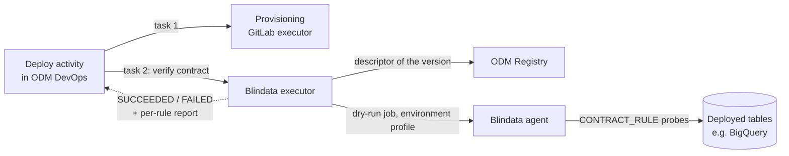

# ODM Platform DevOps Executor for Blindata

> Run the **ODCS data contract declared in a data product descriptor** with the **Blindata agent**, as a task of the [Open Data Mesh Platform](https://dpds.opendatamesh.org/) DevOps deploy: the contract's quality rules are checked on the data just deployed, and the deploy fails when a blocking rule fails.

[](https://opensource.org/licenses/Apache-2.0)
[](https://openjdk.org/)
[](https://quarkus.io/)

## What it does

The data contract of a data product lives in its descriptor: the ODCS 3.1 `quality` rules of the tables and columns of each output port. This executor lets you **run that contract with the Blindata agent**, with no extra definition in Blindata or in the pipeline. When a version is deployed to an environment, a **"verify contract"** task runs after the provisioning task. DevOps hands it to this executor, which:

1. reads the version's descriptor from the ODM **Registry**;
2. turns its executable rules into one **dry-run** job of `CONTRACT_RULE` probes and runs it on the **Blindata agent**, against the tables just deployed;
3. answers **`SUCCEEDED`** or **`FAILED`**: the task fails when a **blocking** rule fails, and the activity fails with it, so the next stage (for example prod) cannot start;
4. leaves the **per-rule report** in the task's results and logs.



Nothing is written to Blindata at deploy time. Each environment's Blindata observer creates tables, checks and scheduled probes in its own tenant only **after** the deploy succeeds; the report in ODM is the record of every deploy-time check, failed ones included.

## Which ODCS constructs run

| ODCS construct | Supported |
|:--|:--|
| Rule types | `library`, `sql` (`text` and `custom` are reported as skipped) |
| Library metrics | `rowCount`, `nullValues`, `missingValues`, `invalidValues` (`validValues`, `pattern`), `duplicateValues` (column, or several columns) |
| Operators | `mustBe`, `mustNotBe`, `mustBeGreaterThan`, `mustBeGreaterOrEqualTo`, `mustBeLessThan`, `mustBeLessOrEqualTo`, `mustBeBetween`, `mustNotBeBetween` (one per rule) |
| Units | `rows`, `percent` |
| SQL rules | any query returning one number, with `{object}` and `{property}` placeholders |
| Levels | table (`quality`) and column (`properties.<column>.quality`) |
| Blocking | blocking by default; `customProperties` `blocking: false` makes a rule non-blocking |

Details, examples and platform limits (for example `pattern` on BigQuery): [ODCS support](docs/reference/odcs-support.md).

## Capabilities

- **One source of truth.** The rules are the ODCS `quality` rules of the descriptor, read the same way as the Blindata observer and TEST RULES in the Builder: same check codes, same physical binding.
- **Blocking and non-blocking rules.** A rule is blocking unless its `customProperties` say `blocking: false`; non-blocking failures are reported without failing the deploy.
- **Fail-closed.** A blocking rule that cannot be measured (missing table, SQL error, no result) fails the task too.
- **Checked before running.** Rules the agent cannot run on the environment's platform (for example a regex rule on BigQuery) are refused at start, with the SQL rule to write instead.
- **One executor for every environment.** Environment profiles map each environment to its Blindata tenant, credentials and connection; one agent can serve them all.
- **API key or OAuth2.** The same authentication options as the Blindata observer, including Microsoft Entra ID service principals (secret or certificate).
- **Stateless.** No database: everything travels in the run id and in the agent job. Run any number of replicas.
- **A fallback without the executor.** A small script runs the same check from the last stage of the provisioning pipeline.

## Get started

1. **Write the contract** in the descriptor: [ODCS support](docs/reference/odcs-support.md) and [Contract rules](docs/reference/contract-rules.md).
2. **Prepare Blindata**: a technical identity and an agent connection per environment, see [Blindata setup](docs/reference/blindata-setup.md).
3. **Run the executor** with one profile per environment: [Build, run and deploy](docs/reference/build-and-run.md) and the [Configuration reference](docs/reference/configuration-reference.md).
4. **Plug it into DevOps** and declare the task in the descriptor: [DevOps setup](docs/reference/devops-setup.md).

```yaml
# Descriptor: the deploy activity of one environment
lifecycleInfo:
  deploy-lab:
    - name: provisioning
      service: { $href: gitlab }
    - name: verify-contract
      service: { $href: blindata }
      template: { definition: {} }
      configurations:
        params:
          dataProductFqn: urn:dpds:acme:dataproducts:orders:1
          environment: lab
          activityName: deploy-lab
          taskName: verify-contract
```

## In depth

| Document | Contents |
|:--|:--|
| [Concepts](docs/reference/concepts.md) | Architecture, what happens on start, status, logs and cancel, verdict rules, statelessness, topology with one tenant per environment |
| [ODCS support](docs/reference/odcs-support.md) | Where the contract lives in the descriptor, every supported ODCS construct (types, metrics, operators, units, SQL), platforms, what is not supported |
| [Contract rules](docs/reference/contract-rules.md) | Which rules run, blocking flag, check codes and physical binding, what the agent cannot run, writing rules for deploy time |
| [Blindata setup](docs/reference/blindata-setup.md) | Technical identity (API key or OAuth2 / Entra ID), roles, agent connection per tenant |
| [DevOps setup](docs/reference/devops-setup.md) | Registering the executor, declaring the task, results in DevOps, gating the next stage |
| [Configuration reference](docs/reference/configuration-reference.md) | Every property, default, environment variable and validation rule |
| [API reference](docs/reference/api-reference.md) | The four executor endpoints, payloads, errors, the report format |
| [Build, run and deploy](docs/reference/build-and-run.md) | Maven and Docker builds, profiles file, tests, local end-to-end run |
| [Fallback without the executor](docs/reference/fallback.md) | Running the same check from the provisioning pipeline |
| [Troubleshooting](docs/reference/troubleshooting.md) | Common errors and what they mean |

Design notes: [`spdd/analysis`](spdd/analysis).
