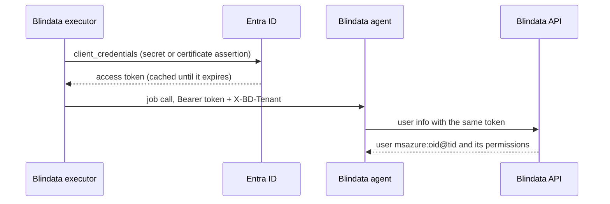

# Blindata setup

Per environment the executor needs a Blindata **tenant**, a **technical identity** with the agent roles in that tenant, and an **agent connection** that reaches the environment's data.

## Technical identity

The identity needs the permissions **`AGENTS_EDITOR`** (start a job) and **`AGENTS_VIEWER`** (read the job and its log) in the tenant. It is the identity of the platform, not of the person who deploys: the executor never forwards user credentials. Two options, the same as the Blindata observer:

| Option | Profile keys | Sent to the agent |
|:--|:--|:--|
| API key | `auth.type: API_KEY`, `auth.api-key.user`, `auth.api-key.key` | `X-BD-User`, `X-BD-ApiKey`, `X-BD-Tenant` |
| OAuth2 client credentials | `auth.type: OAUTH2_CLIENT_CREDENTIALS`, `auth.oauth2.*` | `Authorization: Bearer <token>`, `X-BD-Tenant` |

The agent forwards the bearer token to the Blindata API, so it accepts any token the API accepts.

### OAuth2 with Microsoft Entra ID



1. **In Entra ID**: register an application for the executor, with a client secret or a certificate, and give it access to the Blindata API application. The Blindata API application must issue v2 tokens.
2. **In each Blindata tenant**: create the user `msazure:<object id>@<Entra tenant id>` for the executor's service principal, with `AGENTS_EDITOR` and `AGENTS_VIEWER`, and check the tenant's Azure authentication settings (audience, Entra tenant).
3. **In the profile**:

```yaml
auth:
  type: OAUTH2_CLIENT_CREDENTIALS
  oauth2:
    url: https://login.microsoftonline.com/<entra-tenant-id>/oauth2/v2.0/token
    grant-type: client_credentials
    scope: api://<blindata-api-app-id>/.default
    client-id: ${BLINDATA_PRD_OAUTH2_CLIENT_ID}
    client-secret: ${BLINDATA_PRD_OAUTH2_CLIENT_SECRET}
```

For a certificate, set `client-certificate` and `client-certificate-private-key` (PEM, PKCS#8) instead of `client-secret`: the executor sends a signed client assertion. The Blindata API accepts its own tokens and Entra ID v2 tokens; other identity providers are not accepted by the API today.

## Agent connection

Each rule runs on the connection named in the port's `x-blindataConnectionName`. That name must resolve in the agent for each environment:

- **Connections scoped per tenant** (one tenant per environment): create in each tenant a connection with the same name, pointing to that environment's data. Leave `connection-name-template: "{name}"`.
- **Shared connection catalogue**: create one connection per environment, for example `sales-dwh-lab` and `sales-dwh-prd`, and set `connection-name-template: "{name}-{environment}"`.

The agent's service account needs read access to the datasets of the data product. On BigQuery, the connection's default project is the environment's project, and the descriptor's `databaseSchemaName` is the dataset.

## Results are not written to Blindata

The job always runs with `dryRun: true`. Blindata receives tables, checks and probes from each environment's observer after the deploy succeeds, and the scheduled probes then produce the check history. The executor's check codes are the same as the observer's, so the report and the Blindata checks name the same rules.
