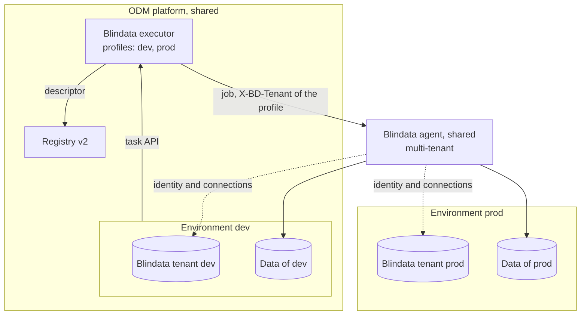
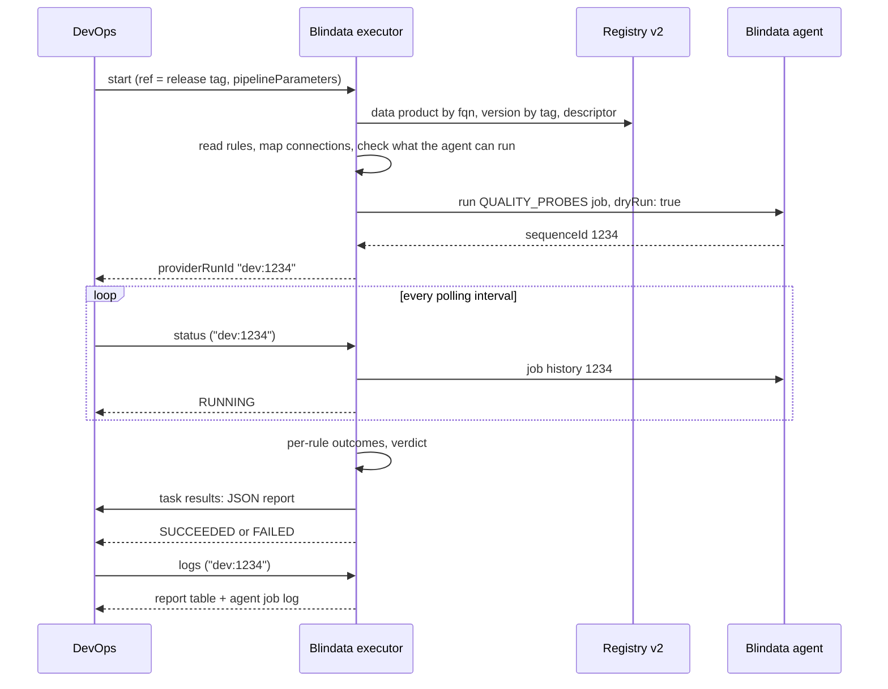
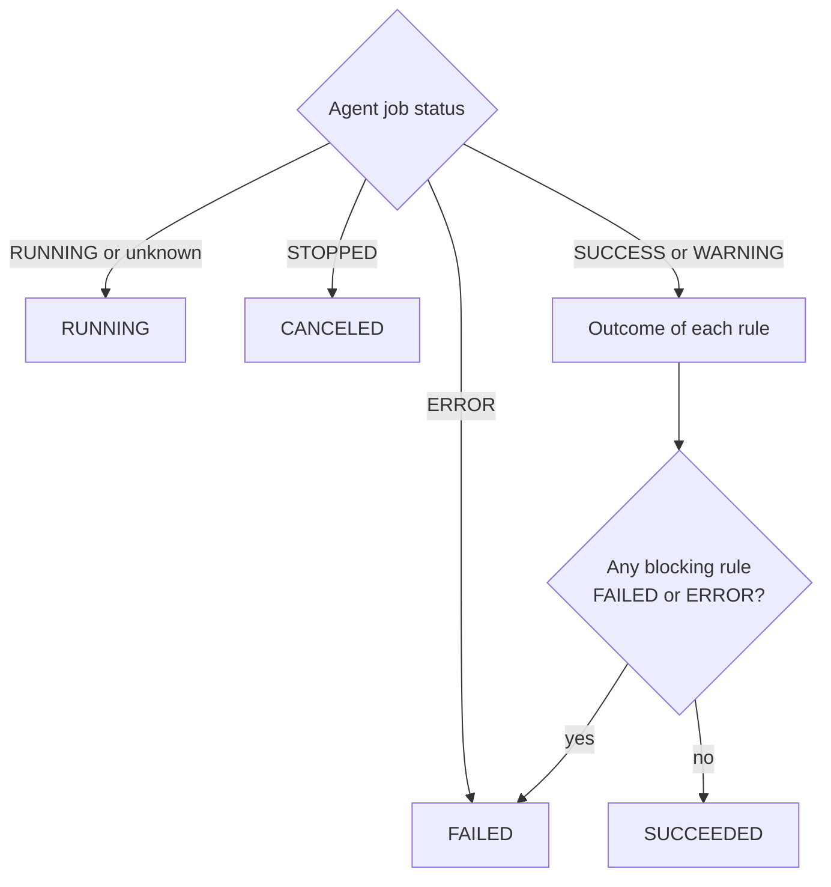

# Concepts

## Where the executor sits

One ODM platform serves every environment. Each environment (for example `dev` and `prod`, one GCP project each) has its own Blindata **tenant**; one Blindata **agent** can serve all tenants. The executor is a single service: an **environment profile** tells it, for each environment, which agent, tenant, credentials and connection naming to use.

## One run, step by step

DevOps drives the run through the four calls of the executor API. The executor keeps nothing between calls.

| Call | What the executor does |
|:--|:--|
| `start` | Finds the version (by `dataProductVersion` when given, else by the release tag), reads the executable rules, resolves each rule's connection for the environment, refuses blocking rules the agent cannot run there, launches one dry-run job. Returns `<environment>:<sequenceId>`. |
| `status` | Reads the job. Running: `RUNNING`. Ended: computes the verdict, posts the report to the task's results in DevOps, then answers the terminal status. |
| `logs` | The report as a table, followed by the agent job log. |
| `cancel` | The agent cannot stop an ad-hoc job: a running job is accepted and ends on its own; an ended job is a conflict (409). |

## How the verdict is decided

The agent's job status is **not** the verdict: a rule that fails (score 0) does not fail the agent job. The executor looks at every rule.

| Agent row for a rule | Outcome |
|:--|:--|
| score above 0 | `PASSED` |
| score 0 | `FAILED` |
| error row, no score, or no row at all | `ERROR` |
| rule not sent (see [Contract rules](contract-rules.md)) | `SKIPPED` |

Structural checks are always blocking. With no executable rule the run succeeds, with a note in the report.

## Where the result lives

The deploy-time check never writes to Blindata (`dryRun: true`). Its record is the ODM task:

- **Results**: a JSON report posted to `POST /api/v2/pp/devops/activities/tasks/results` while the task is still running, when the DevOps service is configured and the task declares `activityName` and `taskName`. The DevOps UI shows it in the task's Results tab; later tasks and policies can read it.
- **Logs**: the same report as a table, always, rebuilt from the agent job history on every call.

If the results post fails, the verdict does not change and the report stays in the logs.

## Statelessness

| What the status call needs | Where it comes from |
|:--|:--|
| The environment (agent, tenant, credentials) | The run id: `<environment>:<sequenceId>` |
| The rules, their blocking flag and port | The job itself: `configs.checks[].odm`, kept by the agent in the job history |
| The rules skipped at start | `configs.skipped` in the job |
| Data product, version, tag, activity and task names | `configs.odm` in the job |

The agent ignores these extra fields when it runs the job. The only cache is the OAuth2 token, which is a performance cache: a restart only costs one token call.
