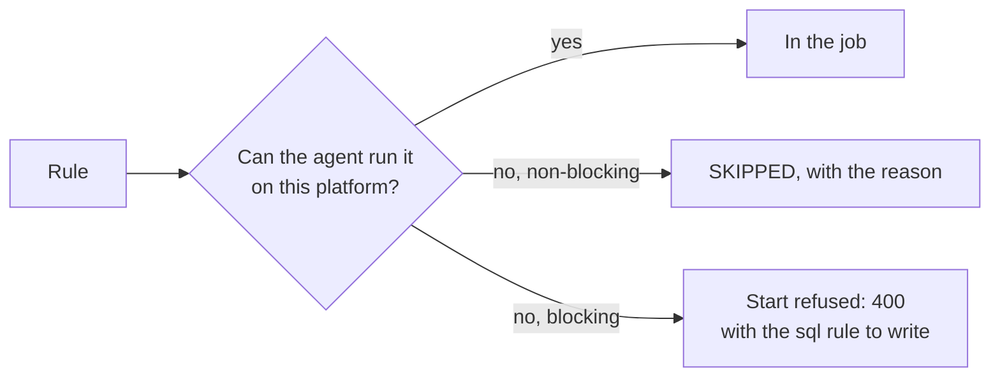

# Contract rules

## Which rules run

The executor reads every port whose `promises.api` is a **datastore API** and that declares `x-blindataConnectionName` (the property name is configurable). For each table of the schema it takes the `quality` rules of the table and of its columns.

| Rule | What happens |
|:--|:--|
| `type: library` or `type: sql`, with an `id` | Sent to the agent |
| no `type` | `library` if it has a `metric`, `sql` if it has a `query` |
| `type: text` or `custom` | `SKIPPED`: not executable |
| no `id` | `SKIPPED`: the check code needs a stable id |
| port without connection name | `SKIPPED` |
| the same check code twice | the first is kept, the second `SKIPPED` |
| quality reference (`customProperties.refName`), legacy rule (`scoreStrategy`) | ignored |

Each rule becomes one `CONTRACT_RULE` check, as the Blindata observer and TEST RULES build it:

- **check code** `<domain> - <data product name> - <rule id>`, the same code as the Blindata check the observer creates;
- **physical binding** `schema` = `databaseSchemaName`, `object` = table name, `property` = column (column rules only);
- **rule** = the ODCS rule without its catalog-only keys (`id`, `name`, `description`, `dimension`, `severity`, `businessImpact`, `tags`, `authoritativeDefinitions`, `scheduler`, `schedule`, `customProperties`).

```yaml
quality:
  - id: orders_not_empty
    type: library
    metric: rowCount
    mustBeGreaterThan: 0
  - id: order_id_unique
    type: library
    metric: duplicateValues
    mustBe: 0
    customProperties:
      - property: blocking
        value: false
```

## Blocking flag

A rule is **blocking** unless its `customProperties` set the key `blocking` to `false`. Both forms are read, with a boolean or a string value:

```yaml
customProperties: [{ property: blocking, value: false }]   # ODCS list form
customProperties: { blocking: "false" }                     # object form
```

A blocking rule that fails or cannot be measured fails the task. A non-blocking one is reported only.

## What the agent cannot run

The agent builds the SQL of `library` rules without a dialect switch and writes identifiers unquoted. The environment profile's `platform` tells the executor which limits apply; rules are checked at start.

| Limit | Platforms | Why |
|:--|:--|:--|
| `invalidValues` with `arguments.pattern` | `BIGQUERY` | the agent emits `REGEXP_LIKE` and `CAST(... AS VARCHAR)`, which BigQuery does not have |
| schema, table, column, `duplicateValues` properties outside `[a-zA-Z0-9_]+` | all | identifiers are emitted unquoted |
| library metric other than `nullValues`, `missingValues`, `invalidValues`, `duplicateValues`, `rowCount` | all | not implemented by the agent |
| `library` rule, or `sql` rule using `{object}`, without schema and table | all | the binding is needed to build the SQL |



A blocking rule is refused instead of skipped because skipping it would silently weaken the gate. Rewrite it as a `sql` rule; the error message gives an example:

```sql
SELECT COUNT(*) FROM {object} WHERE {property} IS NULL OR NOT REGEXP_CONTAINS(CAST({property} AS STRING), r'^[A-Z]{2}$')
```

On BigQuery the binding schema is the **dataset** only. The project comes from the connection's default project, one connection per environment, so the descriptor stays the same in every environment.

## Writing rules for deploy time

- **`invalidValues` counts NULL as invalid** (`col IS NULL OR NOT (...)`). On a nullable column, write a `sql` rule if NULL is allowed. The report adds a note when such a rule fails.
- **Tables may be empty at the first deploy.** Value rules then pass or fail for the wrong reason. Make blocking only the rules that are meaningful right after a deploy.
- **There is no time window.** Library metrics scan the whole table on every deploy. On large or high-frequency tables write `sql` rules on the latest partition:

```yaml
- id: orders_latest_partition
  type: sql
  query: SELECT COUNT(*) FROM {object} WHERE ingestion_date = (SELECT MAX(ingestion_date) FROM {object})
  mustBeGreaterThan: 0
```
