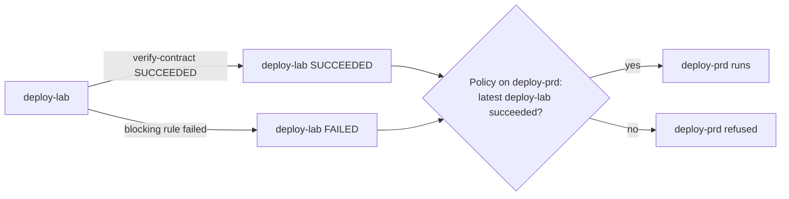

# DevOps setup

## Register the executor

On the DevOps server (`odm-platform-pp-devops-server`):

```yaml
odm:
  utility-plane:
    executors:
      polling-interval: 30s
      services:
        blindata:
          address: http://odm-platform-adapter-devops-executor-blindata:9080
          execution-mode: full-control
```

In the Blindata agent's DevOps configuration, declare the executor `blindata` with **no secrets**: the executor uses the identity of its environment profiles, so the UI asks the user for none.

DevOps needs the Notification service to approve executions, even with the Policy service off; without it an activity stays `PENDING`.

## Declare the task

In the descriptor, add the task after the provisioning task of each deploy activity:

```yaml
lifecycleInfo:
  deploy-lab:
    - name: provisioning
      service: { $href: gitlab }
      # ...
    - name: verify-contract
      service: { $href: blindata }
      template: { definition: {} }
      configurations:
        params:
          dataProductFqn: urn:dpds:acme:dataproducts:orders:1
          environment: lab
          activityName: deploy-lab
          taskName: verify-contract
  deploy-prd:
    - name: provisioning
      service: { $href: gitlab }
    - name: verify-contract
      service: { $href: blindata }
      template: { definition: {} }
      configurations:
        params:
          dataProductFqn: urn:dpds:acme:dataproducts:orders:1
          environment: prd
          activityName: deploy-prd
          taskName: verify-contract
```

| Parameter | Required | Meaning |
|:--|:--|:--|
| `dataProductFqn` | yes | The data product. The version comes from the release tag DevOps sends in `executorParameters.ref.name`. |
| `environment` | yes | Key of the executor's environment profile. |
| `dataProductVersion` | no | Version number, when it must win over the tag. |
| `activityName`, `taskName` | no | Needed to post the report to this task's results. Without them the report is in the logs only. |

DevOps requires a repository in the task's executor parameters (`dataProductRepo.providerType`); the executor ignores it.

## Gate the next stage

A failed verification fails the task, which fails the activity. To stop `deploy-prd` until `deploy-lab` has succeeded, write a policy on the `deploy-prd` activity request that reads `otherActivities` and requires the latest `deploy-lab` to be `SUCCEEDED`. DevOps v2 does not send a separate stage-transition event.



## The report in DevOps

When the run ends, the executor posts one result to the task, a JSON document:

```json
{
  "schema": "blindata.devops.contractVerification.v1",
  "dataProduct": "urn:dpds:acme:dataproducts:orders:1", "version": "1.2.0", "environment": "lab",
  "agentRun": { "sequenceId": 1234, "runStatus": "SUCCESS", "startedAt": "…", "finishedAt": "…" },
  "verdict": "FAILED",
  "summary": { "total": 9, "passed": 4, "failed": 2, "error": 0, "skipped": 3, "failedBlocking": 1 },
  "rules": [
    { "checkCode": "sales - orders - order_id_not_null", "ruleId": "order_id_not_null", "name": "order_id_not_null",
      "port": "…:outputPorts:orders", "object": "orders", "property": "order_id", "kind": "RULE",
      "blocking": true, "outcome": "FAILED", "metric": 1, "totalElements": null, "score": 0, "error": null, "note": null }
  ],
  "skipped": [ { "ruleId": "orders_documentation", "reason": "type text is not executable", "…": "…" } ],
  "notes": []
}
```

Later tasks of the same activity, and task-level policies, can read it from `activity.tasks[].results`.
