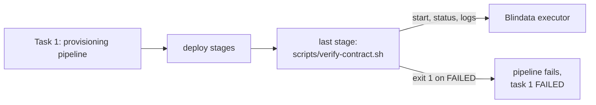

# Fallback without the executor

When the executor cannot be registered in DevOps, the same check can run from the **last stage of the provisioning pipeline** (a GitLab job or a Cloud Build step). The stage calls this executor's own API, so the logic is not duplicated: only DevOps no longer drives it.



The check must be part of the provisioning task: DevOps does not start a second task while the first one is running.

```bash
EXECUTOR_URL=http://odm-platform-adapter-devops-executor-blindata:9080 \
DATA_PRODUCT_FQN=urn:dpds:acme:dataproducts:orders:1 \
ENVIRONMENT=lab RELEASE_TAG="$CI_COMMIT_TAG" \
ACTIVITY_NAME=deploy-lab TASK_NAME=provisioning \
scripts/verify-contract.sh
```

The script prints the report and exits 1 when the verification is `FAILED` or `CANCELED`. With `ACTIVITY_NAME` and `TASK_NAME` set, the report is also posted to that task's results. It needs `curl` and `jq`, and the pipeline runners must reach the executor.
