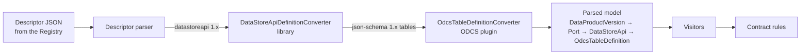

# Internals

How the executor is built, for whoever changes it. Users of the executor do not need this page: see [ODCS support](odcs-support.md) and [Concepts](concepts.md).

## Layout

The service follows the norms of the Blindata backend service template (`spdd/norms`), rendered from `blindata-backend-service-template-quarkus` 1.1.1 with the `usecases`, `http-service` and `rest-client` modules. Base package `org.opendatamesh.platform.up.executor.blindata`:

| Package | Contents |
|:--|:--|
| `rest.v2` | The DevOps executor API: `ExecutorTaskController`, request and response resources and their mapper, the error mapper |
| `tasks.services` | `ExecutorTaskUseCasesService`, and one use case per call in `usecases.start`, `.status`, `.logs`, `.cancel` (command, presenter, outbound ports and their implementations, factory) |
| `tasks.services.descriptor` | Reading the ODCS contract from the descriptor (below) |
| `tasks.model` | Domain types: environment profile, contract rule, agent run, verdict (`ContractVerdict`), report |
| `clients.registry`, `clients.agent`, `clients.devops` | One client per external system: Registry v2, Blindata agent (job wire format, credentials, platform limits in `AgentRuleSupport`), DevOps v2 task results |
| `config` | Typed configuration (`odm.product-plane.*`, `blindata.*`), environment profiles, startup validation |
| `exceptions`, `utils` | The service exception hierarchy; template-owned utilities (HTTP client with OAuth2, use case base types) |

## Reading the ODCS contract from the descriptor

The executor uses the ODM **descriptor parser library** (`odm-specification-dpdescriptor-parser`) and plugs an **ODCS plugin** into it:

| Piece | Role |
|:--|:--|
| `Parser` (library) | Parses the descriptor into the DPDS model (`DataProductVersion`, ports, promises) |
| `DataStoreApiDefinitionConverter` (library) | Turns each port's `datastoreapi` definition into a `DataStoreApi` |
| `OdcsTableDefinitionConverter` (this executor, plugin) | A `DataStoreApiStandardDefinitionConverter` registered on the datastore API parser: turns each `json-schema` 1.x table definition into an `OdcsTableDefinition` with its table and column `quality` rules (`OdcsQualityRule`), keeping every ODCS key as written |
| Visitors (this executor) | Walk the model with the library's visitor interfaces: `DataProductVersionVisitor` (info, ports) → `InterfaceComponentsVisitor` / `PortVisitor` / `PromisesVisitor` (connection name, API) → `StandardDefinitionVisitor<DataStoreApi>` and `DataStoreApiVisitor` / `DataStoreApiSchemaVisitor` (schema, tables) → `ComponentBaseVisitor<OdcsTableDefinition>` (rules) |
| `ContractRulesCollector` | Applies the mapping to each rule met: check code, binding, blocking flag, skip reasons |

Code (`tasks.services.descriptor`):

| Package | Contents |
|:--|:--|
| `descriptor` | `DescriptorContractRulesReader`: the entry point, parse then walk |
| `descriptor.parser` | `DescriptorParser`: the library parser with the datastore API converter and the ODCS plugin registered; reflection registration for the native image |
| `descriptor.odcs` | `OdcsTableDefinitionConverter`: the ODCS plugin |
| `descriptor.odcs.model` | `OdcsTableDefinition`, `OdcsPropertyDefinition`, `OdcsQualityRule`: the model the plugin produces |
| `descriptor.visitors` | `ContractRulesWalker` (the only public type), the four visitors, `ContractRulesCollector` and `RuleLocation` |

The descriptor model is registered for reflection (`parser.DescriptorModelReflection`) because Jackson binds it reflectively in the native image.

## The verification job

`clients.agent.AgentJobMapper` writes one `QUALITY_PROBES` job of `CONTRACT_RULE` checks, always with `outputOptions.dryRun: true`. The executor's own data travels in fields the agent ignores and keeps in its job history: `configs.odm` (data product, version, tag, environment, activity and task names), `configs.checks[].odm` (rule id, name, port, type, blocking flag, kind) and `configs.skipped`. The status, logs and cancel calls read them back, so the service keeps no state.
