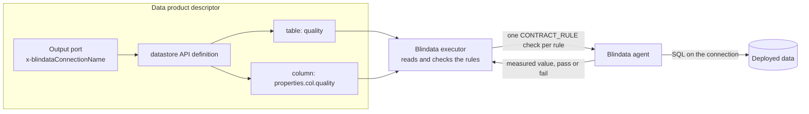

# ODCS support

The executor runs the **data contract declared in the descriptor**: the [ODCS 3.1 data quality rules](https://bitol-io.github.io/open-data-contract-standard/v3.1.0/data-quality/) of each output port, executed by the **Blindata agent** as `CONTRACT_RULE` probes against the deployed data. Nothing has to be redefined in Blindata or in the pipeline: the descriptor is the single source of the contract.



## Where the contract lives in the descriptor

```yaml
interfaceComponents:
  outputPorts:
    - fullyQualifiedName: urn:dpds:acme:dataproducts:orders:1:outputPorts:orders
      x-blindataConnectionName: sales-dwh                 # agent connection that reaches the data
      promises:
        api:
          specification: datastoreapi
          definition:
            schema:
              databaseSchemaName: sales                   # schema (BigQuery: dataset)
              tables:
                - name: orders
                  definition:
                    name: orders
                    quality:                              # table-level rules
                      - id: orders_not_empty
                        type: library
                        metric: rowCount
                        mustBeGreaterThan: 0
                    properties:
                      order_id:
                        quality:                          # column-level rules
                          - id: order_id_not_null
                            type: library
                            metric: nullValues
                            mustBe: 0
```

Every port of the descriptor is read; ports without `x-blindataConnectionName` are reported as skipped. The datastore API `definition` may be inline or a JSON string, and internal `$ref`s are resolved.

## Supported ODCS constructs

### Rule types

| `type` | Supported | How it runs |
|:--|:--|:--|
| `library` | **yes** | The agent builds the SQL from the metric (table below) |
| `sql` | **yes** | The agent runs your `query`; it must return one number |
| `text` | no, reported as skipped | Documentation only |
| `custom` | no, reported as skipped | Vendor-specific (e.g. a dbt or Soda rule); not run by Blindata |
| missing | inferred | `sql` when the rule has a `query`, `library` when it has a `metric` |

### Library metrics

| `metric` | Level | `arguments` | What is measured |
|:--|:--|:--|:--|
| `rowCount` | table | — | rows in the table |
| `nullValues` | column | — | rows where the column is NULL |
| `missingValues` | column | `missingValues`: list of values (`null`, strings, numbers) that count as missing | rows whose value is in the list |
| `invalidValues` | column | `validValues`: list of strings or numbers, and/or `pattern`: a regular expression | rows whose value is not valid; **NULL counts as invalid** |
| `duplicateValues` | column, or table with `arguments.properties: [col, ...]` | `properties` (table level) | rows beyond the first for each duplicated value (or combination) |

Metric names are case-insensitive; the deprecated `rule` key is accepted in place of `metric`.

### Comparison operators

Each rule has **exactly one** operator, compared with the measured value:

| Operator | Passes when the value is |
|:--|:--|
| `mustBe` / `mustNotBe` | equal / not equal to the number |
| `mustBeGreaterThan` / `mustBeGreaterOrEqualTo` | above / at least the number |
| `mustBeLessThan` / `mustBeLessOrEqualTo` | below / at most the number |
| `mustBeBetween` / `mustNotBeBetween` | inside / outside `[min, max]`, bounds included |

To express a range, use `mustBeBetween` rather than two operators.

### Units

| `unit` | Measured value |
|:--|:--|
| `rows` (default) | the raw count |
| `percent` | the count as a percentage of the table's rows |

```yaml
- id: email_mostly_present
  type: library
  metric: nullValues
  unit: percent
  mustBeLessThan: 5          # less than 5% of the rows have no email
```

### SQL rules

| Construct | Supported |
|:--|:--|
| `query` returning one number, compared with the operator | yes |
| `{object}` placeholder | yes: replaced by `<schema>.<table>` of the binding |
| `{property}` placeholder | yes, on column-level rules: replaced by the column |
| any SQL of the connection's dialect | yes: the query is sent as written |

```yaml
- id: orders_latest_partition
  type: sql
  query: SELECT COUNT(*) FROM {object} WHERE ingestion_date = (SELECT MAX(ingestion_date) FROM {object})
  mustBeGreaterThan: 0
```

### Other fields

| Field | Use |
|:--|:--|
| `id` | **required**: the check code is `<domain> - <data product name> - <id>` |
| `customProperties` `blocking: false` | marks the rule non-blocking (see [Contract rules](contract-rules.md#blocking-flag)) |
| `name`, `description`, `dimension`, `severity`, `businessImpact`, `tags`, `authoritativeDefinitions` | catalogue only: shown in Blindata, not sent to the agent |
| `scheduler`, `schedule` | not used at deploy time; scheduled monitoring is done by the agent probes Blindata creates after the deploy |
| `customProperties.refName` (quality reference) | ignored: the referenced rule is run where it is declared |
| `engine`, `implementation` | passed through and ignored by the agent |

## Platforms

The agent runs contract rules on **JDBC** and **MongoDB** connections. The library SQL has no dialect switch, so some constructs cannot run everywhere; the executor checks them at start against the environment's `platform`:

| Construct | GENERIC (e.g. PostgreSQL 15+) | BIGQUERY |
|:--|:--|:--|
| `rowCount`, `nullValues`, `missingValues`, `duplicateValues` | yes | yes |
| `invalidValues` with `validValues` | yes | yes |
| `invalidValues` with `pattern` | yes, where the database has `REGEXP_LIKE` | **no**: write a `sql` rule with `REGEXP_CONTAINS` |
| identifiers outside `[a-zA-Z0-9_]+` | no | no |
| `sql` rules | yes | yes |

A blocking rule that cannot run refuses the start with the rule to write instead; a non-blocking one is skipped with the reason. See [Contract rules](contract-rules.md#what-the-agent-cannot-run).

## Not supported

- More than one operator in a rule, or a rule with no operator.
- `text` and `custom` rules (reported as skipped).
- Rules without an `id`.
- A time window on library metrics: they scan the whole table; use a `sql` rule on the latest partition.
- Data contracts outside the descriptor (e.g. a separate ODCS YAML file).
