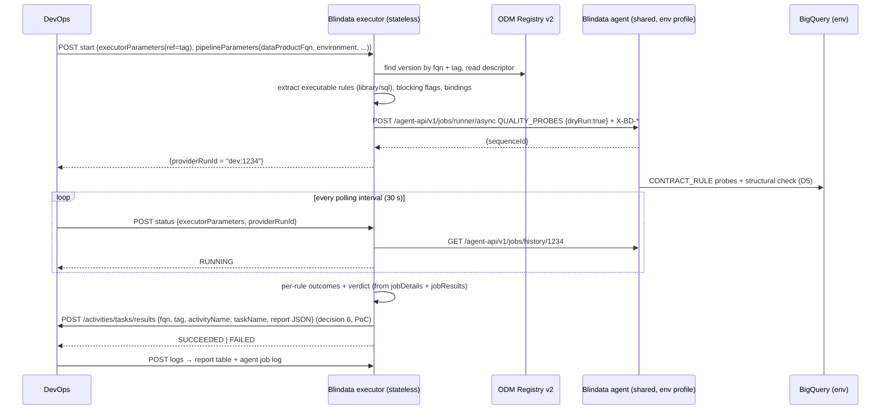

# SPDD Analysis: Blindata DevOps executor (contract verification via the agent)

Story **BDMD-5755**, item **D6** of the BDMD-5587 proposal (comment of 2026-11-18). Repository [`opendatamesh-initiative/odm-platform-adapter-devops-executor-blindata`](https://github.com/opendatamesh-initiative/odm-platform-adapter-devops-executor-blindata) (public; the story's branch is `feat/BDMD-5755-blindata-executor`). It implements the DevOps v2 executor API (`odm-platform-pp-devops-server`) for one task: **verify the data contract** of a data product version in one environment, by running the contract rules on the Blindata agent.

**Revision 5 (implementation).** The analysis now describes what was built on `feat/BDMD-5755-blindata-executor`, not only what was planned. Changes from revision 4:
- descriptor parsing through the ODM descriptor parser library, an ODCS plugin and the library's visitors (decision 3);
- authentication through the template's OAuth2 client, the same code as the observer, without the early refresh and 401 retry (decision 5, F-8);
- more checks at start: unknown metrics, a missing or doubled operator, a malformed range (decision 13);
- no command-line core for the fallback: F1 calls the HTTP API (decision 11);
- template 1.1.1, public repository (decision 12, Q8 answered);
- configuration, edge cases, risks and test strategy updated; the local end-to-end run is recorded (Test strategy).

**Revision 4.** The quality rules live in the descriptor and only the agent runs them, so this executor is the only blocking quality gate (dbt tests D1 and run_results upload D10 moved to the backlog as a fallback). Adds the agent's BigQuery SQL limits (decision 13: `invalidValues` with `pattern`, identifiers), the missing time window, example environment names (`dev`, `prod`), the pipeline-tool question for fallback F1. Q4 answered.

**Revision 3.** Adds the requirement to support OAuth scenarios like Microsoft Entra ID, as well as API keys, for Blindata authentication, aligned with what the Blindata observer supports (decision 5, T8, Q11, F-5). Suggested configuration rewritten on the ODM services pattern (`odm.product-plane.<name>-service`, `blindata.*` group, `auth.type`, mounted profiles file).

**Revision 2.** Aligned with the BDMD-5587 approach: one tenant per environment, one shared executor and agent, observers per environment, results of the deploy-time check in ODM only, BDMD-5717 (D7) dropped. Revision 1 was the first pass.

Sources used:

- Jira BDMD-5755, BDMD-5687 (D2), BDMD-5757 (D3/D4), BDMD-5756 (D5), BDMD-5651 (D9), BDMD-5758 (D10), BDMD-5650 (D11), BDMD-5688.
- BDMD-5587: the current approach and the earlier proposals. D7 (BDMD-5717, checks creatable before the table) is closed and dropped; D8 is now observer configuration only (handler on the completed activity of its own stage, no new code).
- The design decision "quality checks in the descriptor, run by the agent, not dbt tests".
- Comments on BDMD-5755, BDMD-5757, BDMD-5655 and BDMD-5632, checked against the code.
- The agent's SQL generation for `CONTRACT_RULE` library rules: `ContractRuleJdbcLibrary` (`invalidPredicate`, `safeIdent`).
- The GitLab executor: `odm-platform-adapter-devops-executor-gitlab` (analysis BDMD-5099 revision 3, code: status mapping, stateless use cases, configuration).
- The DevOps v2 server: `docs/service/how-devops-works.md`, `docs/setup/configuration.md`, the executor client resources, `ActivityUseCaseController` (`/tasks/results`), `TaskResult`, the Policy V1 adapter (`old/v1/policyservice`, analysis BDMD-5438).
- The DevOps v1 server in `odm-platform` (`DevopsPolicyServiceProxy`), to place the `ACTIVITY_STAGE_TRANSITION` / `TASK_EXECUTION_RESULT` events mentioned in the proposal.
- The Blindata agent: `JobsRunnerController`, `JobsHistoryController`, `JobHistoryRes`, `JobResultsRes`, `QualityResult`, `jobs/quality/README.md`, `BlindataTokenFilter`, `WebSecurityConfig`.
- The Blindata UI: TEST RULES in the Builder (`BuilderQualityContractTestDialog.tsx`, `builderQualityContractTestUtils.ts`, `builderQualityTestResults.ts`, `ProbesJobConverter.js`, `contractRuleEnvelope.js`), the DevOps v2 execute flow (`ExecuteDevOpsV2ActivityFlow.js`) and the task detail (`OdmTasksPageSection.jsx`).
- The Blindata API (`AgentsController`): to check whether it can dispatch agent jobs.
- The Blindata observer (`odm-platform-adapter-observer-blindata`): `ProbesUpload`, `ProbesUploadOdmOutboundPortImpl`, `ContractRuleEnvelopeBuilder`, `DataStoreApiStandardDefinitionVisitorImpl`.
- The ODM Registry v2 (`DataProductVersionsController`, search options).
- Configuration patterns: `odm-platform-adapter-marketplace-executor-jira` (`application.yml`, `docs/reference/build-and-run.md`), `odm-platform-pp-devops-server` (`odm.product-plane.*`), the observer's `BdCredentials` / `application-docker.yml`.
- `spdd/norms/*` of this repository.

## Original Business Requirement

BDMD-5755 (Italian in Jira, summarised in English):

> New ODM DevOps executor adapter that runs the "verify contract" task of a deploy activity, after the provisioning task (GitLab executor). Item D6 of the BDMD-5587 proposal.
>
> Behaviour:
> 1. Receives the task from DevOps (data product, version, environment).
> 2. Builds the `QUALITY_PROBES` job from the version's descriptor (like TEST RULES in the Builder) and launches it on the agent in `dryRun`, together with the structural check (D5).
> 3. Polls the agent job history.
> 4. Returns SUCCESS / FAILED to DevOps with per-rule detail. FAILED fails the activity, and the stage-transition policy blocks test → prod (BDMD-5651).
>
> Notes: instrumented-only setup (no executor): the same check becomes the last stage of the provisioning pipeline, with the ODM callback. Open point: direct call to the agent (like TEST RULES, simpler for the PoC) or through the Blindata API (agent not exposed, preferred long term).
>
> AC: adapter registered in DevOps and selectable as a task executor; task FAILED when a blocking rule fails, SUCCESS otherwise; per-rule detail visible in the ODM activity.

Context that frames the analysis:

- **The ODCS 3.1 `quality` arrays on the descriptor's output ports are the single source of truth.** One observer per environment writes to its own tenant **only when a deploy activity of its own stage succeeds** (`DATA_PRODUCT_ACTIVITY_COMPLETED` / `ACTIVITY_SUCCEEDED`, filtered on the stage): tables, then quality suite and one check per rule, then `CONTRACT_RULE` probes. `DATA_PRODUCT_VERSION_CREATED` writes nothing to environment tenants. The agent then monitors those checks on a schedule. **Consequence for this executor:** at contract-check time (during the deploy activity) the tables and checks may not exist yet in the environment's tenant, so the executor must not depend on them: it builds everything from the descriptor and never reads or writes Blindata checks. Check codes (`<domain> - <name> - <rule id>`) are identical in every tenant.
- **The deploy activity** is: policy pre-deploy (D9) → Task 1, provisioning executor (GitLab, or another pipeline tool, see decision 11) → **Task 2, Blindata executor (this story)** → the next activity (`prod`), gated by the stage-transition policy.
- **This executor is the only blocking quality gate .** The rules live in the descriptor and only the agent runs them: at deploy (this executor) and afterwards as scheduled probes. There are no dbt tests in the pipeline: D1 (descriptor → dbt tests, BDMD-5679) and D10 (`run_results.json` upload, BDMD-5758) are in the backlog as a fallback, not parallel paths.
- **Fallback.** If the executor is not ready in time, the fallback (F1) runs the same check from the provisioning pipeline.

## Domain Concept Identification

### Existing Concepts (from codebase)

- **DevOps v2 executor API** (`/api/v2/up/executor/tasks/{start,status,logs,cancel}`, all `POST`, every body carries `executorParameters`). Start adds `pipelineParameters` (free `Map<String,String>`, placeholders `${activity.results.task.path}` already resolved). Status, logs and cancel add `providerRunId` (opaque, ≤255 chars). Status answers `RUNNING | SUCCEEDED | FAILED | CANCELED`. Logs answer one `{content, generatedAt}` block, read once after the run ends. **The executor "knows nothing about activities, versions or policies"** (DevOps docs §4): neither the activity uuid, nor the data product, nor the task name reach it.
- **What the UI sends for a task** (`ExecuteDevOpsV2ActivityFlow.planDevOpsV2Execution`): `executorName` = descriptor `task.service.$href`; `executorParameters` = `{repositoryKey?, dataProductRepo, ref: {name: release.tag, type: TAG}, pipelineIdentifier?}`; `pipelineParameters` = descriptor `task.configurations.params`. The activity itself carries `dataProductVersionUuid`, `dataProductFqn`, `dataProductVersionTag`, `name`, `sortOrder`, but DevOps does not forward them to executors.
- **Task logs and results in DevOps v2.** `TaskLog` and `TaskResult` are text rows on the task. Execute Task appends **one log block** when a full-control run ends. `POST /api/v2/pp/devops/activities/tasks/results` "appends results to a task of either mode", addressed by `activityUuid` **or** by `dataProductFqn` + `dataProductVersionTag` + `activityName` + `taskName`, accepted only while the task is `RUNNING`. The UI task detail has a **Results** tab (JSON content rendered with a JSON viewer) and a **Logs** tab (preformatted text). DevOps v2 has no authentication.
- **Policy on DevOps v2** (Policy V1 adapter, BDMD-5438). DevOps v2 asks Policy before an activity (`ACTIVITY_EXECUTION_RESULT` name, input `{activity, otherActivities}`) and before each task (`TASK_EXECUTION_RESULT` name, input `{activity with tasks and their results, task}`). **`ACTIVITY_STAGE_TRANSITION` is not sent by v2** (DD-3 of BDMD-5438); in `odm-platform` (DevOps v1) it is sent by `DevopsPolicyServiceProxy.isStageTransitionValid`. On v2 the "test → prod" gate is therefore a policy on the `prod` activity request that reads `otherActivities[name = <test activity>].status`. `otherActivities` carry status but no tasks; the task-level request carries the results of the tasks of the *same* activity.
- **GitLab executor** (`odm-platform-adapter-devops-executor-gitlab`, the precedent). Quarkus, template `blindata-backend-service-template-quarkus` 1.1.0 with modules `usecases`, `http-service`, `rest-client`, base package `org.opendatamesh.platform.up.executor.gitlab`. Stateless: everything comes from the request or the remote tool. Status mapping in one place (`RunStatus`), unknown remote statuses → `RUNNING` so the DevOps poll cap bounds the wait. Cancel reads first, then 404 / 409 / 200. Credentials per request as `x-odm-<secretType>` headers, never cached or logged. It reports only the pipeline status and the aggregated job logs, **no results** (the gap also noted for BDMD-5688).
- **This repo before the story.** Starter copy: template 1.1.0 with *all* modules, base package `org.executor`, identity `odm-platform-adapter-devops-executor-starter`, `SimulatedRunStore`. It was re-rendered from the template (decision 12).
- **ODM descriptor parser** (`odm-specification-dpdescriptor-parser`, 2.4.0, used by the Registry, blueprint server and observer). Parses a descriptor into the DPDS model (`DataProductVersion`, ports, promises). Plugins: `DefinitionConverter` for port API definitions (the library's `DataStoreApiDefinitionConverter` turns `datastoreapi` 1.x into a `DataStoreApi`), and `DataStoreApiStandardDefinitionConverter` for table definitions. Traversal through visitor interfaces (`DataProductVersionVisitor`, `InterfaceComponentsVisitor`, `PortVisitor`, `PromisesVisitor`, `StandardDefinitionVisitor`, `DataStoreApiVisitor`, `DataStoreApiSchemaVisitor`, `ComponentBaseVisitor`). It resolves references to other files only, not internal `$ref`s.
- **Blindata agent, job runner.** `POST /agent-api/v1/jobs/runner/async` (role `AGENTS_EDITOR`) takes a `JobRes {type, configs}` and returns a `JobHistoryRes` with a `sequenceId`. `GET /agent-api/v1/jobs/history/{sequenceId}` (role `AGENTS_VIEWER`) returns `runStatus` (`RUNNING`, `SUCCESS`, `WARNING`, `ERROR`, `STOPPED`), `jobDetails` (the `JobRes` sent, `configs` stored as raw JSON), `jobResults {results[], errors[]}`, `startedAt`, `finishedAt`. `GET .../{sequenceId}/logs` returns the job log. There is no API to stop an ad-hoc async job (only the scheduler `interrupt` by key).
- **Agent authentication** (`BlindataTokenFilter`). Either `X-BD-User` + `X-BD-ApiKey` (the agent exchanges them for a token with Blindata) or `Authorization: Bearer <token>`, always with `X-BD-Tenant`. Permissions come from the Blindata user (`ROLE_<permission>`).
- **`QUALITY_PROBES` job and `CONTRACT_RULE` probe.** `configs = {name, checks[], outputOptions?}`; each check is `{code, probe: {type: CONTRACT_RULE, queries: [{connectionName, schema: "blindata.qualityProbe.contractRule.v1", rule, physicalBinding: {schema, object, property?}}]}}`. The agent resolves `connectionName` in its own connection catalog (`connectionType` is not read by the quality engine). Export to Blindata happens only when `outputOptions` is set **and** `dryRun` is false. Each `QualityResult` has `qualityCheckCode`, `metric`, `totalElements`, `score` (`CONTRACT_RULE`: 100 if the operator matches, 0 if not), `error`, timestamps. Rows with an `error` go to `jobResults.errors`, the others to `jobResults.results`. `runStatus` is `WARNING` when the job logged a warning, `SUCCESS` otherwise, even when rules fail: **a failed rule does not fail the job.**
- **TEST RULES in the Builder** (BDMD-5115). For the rules in scope it keeps only `library` and `sql` rules that pass validation (`text` and `custom` are skipped with a warning), strips the catalog-only keys (`id`, `name`, `description`, `dimension`, `severity`, `businessImpact`, `tags`, `authoritativeDefinitions`, `scheduler`, `schedule`, `customProperties`), wraps each rule in the envelope above with the physical binding of the table or column, uses `ruleId || name` as check code, builds the job with `convertProbesToJob(probes, name, {dryRun: true})`, runs it with `runJobAsync`, polls `fetchJobHistory` every second until `runStatus != RUNNING`, and shows each row as passed (score > 0), failed (score 0), error, or unknown. The user picks the agent and the connection by hand.
- **Observer, probe upload** (`ProbesUploadOdmOutboundPortImpl`, Java). Same mapping, server side, from the descriptor: for every port, the declared quality checks of type `library` or `sql`; the connection name from the port property `x-blindataConnectionName` (absent ⇒ the port is skipped on purpose); the physical binding from the descriptor definition (table: schema + name; column: + property); the check code `"<domain> - <name> - <rule code>"`; one probe project per data product and one tag per version.
- **ODM Registry v2.** `GET /api/v2/pp/registry/products-versions?dataProductUuid=&tag=` (short list) and `GET /api/v2/pp/registry/products-versions/{uuid}` (with the descriptor content). The observer reads the descriptor from Registry v2 as well.
- **Blindata API.** Holds the agent registry (`/api/v1/settings/agents`: name, `baseUrl`, pairing). **It has no route that dispatches or proxies agent jobs**: today the UI calls the agent directly at `agent.baseUrl` from the browser.

### New Concepts Required

- **Contract verification run**: one `QUALITY_PROBES` job on the agent of one environment, in dry run, built from the contract rules of one data product version. The provider run id identifies it.
- **Contract rule (executable)**: an ODCS quality rule of type `library` or `sql`, on a port that declares a Blindata connection, with its physical binding, its check code, and its **blocking** flag.
- **Structural check** (D5, BDMD-5756): one extra check in the same job that compares the port's declared columns and logical types with the real table. Its interface is defined by BDMD-5756.
- **Rule outcome**: `PASSED`, `FAILED`, `ERROR`, `SKIPPED` per rule, plus the blocking flag.
- **Verdict**: `SUCCEEDED` when no blocking rule is `FAILED` or `ERROR`; `FAILED` otherwise.
- **Verification report**: the per-rule detail, as a JSON document (for the task results) and as a readable table (for the task logs).
- **Environment profile**: executor configuration per environment name: agent base URL, tenant, credentials, and the connection to use.

### Key Business Rules

Explicit:

- The descriptor of the version is the only source of the rules. The executor never reads rules from Blindata.
- The job **always** runs in **dry run** (`dryRun: true`): nothing is exported to Blindata at deploy time, whether the run passes or fails (decision of 2026-11-19). **Deploy-time contract-check results are stored in ODM only**: the per-rule outcome in the ODM task (results and logs, decision 6) is the record of the run, including failed deploys.
- Blindata receives quality data only through the observers: each environment's observer writes to its own tenant only when the deploy activity of its own stage succeeds (tables, then checks, then probes). The scheduled probes then produce the Blindata check history.
- **A blocking rule that fails makes the task `FAILED`**, which fails the activity; a non-blocking failure is reported and does not fail it.
- Per-rule detail must be visible in the ODM activity.
- The executor is stateless (same principle as the GitLab executor).
- **Blindata authentication supports API keys and OAuth2 client credentials (secret or certificate), as the Blindata observer does**, so scenarios like Entra ID service principals work (requirement added 2026-11-20; decision 5).

Implicit:

- **The agent's job status is not the verdict.** A job can end `SUCCESS` with failed rules. The executor computes the verdict from `jobResults`.
- **At deploy time tables may be empty.** Value rules can pass or fail for the wrong reason. The proposal says the gate is reliable on structure; value rules are better judged by the scheduled probes (see open question Q5).
- **The status call does not receive `pipelineParameters`.** Everything the executor needs at status time must be in `executorParameters`, in the provider run id, or in the agent job itself.
- **The stage-transition gate is a policy concern, not the executor's.** The executor only makes the `dev` activity fail; D9 (BDMD-5651) writes the policy on the `prod` activity request.

## Strategic Approach

### Solution Direction

- **Same shape as the GitLab executor**: re-instantiate this repo from the template with only `usecases`, `http-service`, `rest-client` (decision 12 of BDMD-5099 applies as is), identity `odm-platform-adapter-devops-executor-blindata` (provisional), base package `org.opendatamesh.platform.up.executor.blindata`.
- **Start**: read `pipelineParameters` (data product, environment), resolve the version from `executorParameters.ref.name`, read the descriptor from Registry v2, extract the executable contract rules (observer parity), build the `QUALITY_PROBES` job (TEST RULES parity) plus the structural check, run it async on the agent of the environment, return `providerRunId = <environment>:<sequenceId>`.
- **Status**: read the job history; while `RUNNING`, answer `RUNNING`; when ended, compute the per-rule outcomes and the verdict from `jobResults` and from the rule metadata stored in the job itself (`jobDetails`), publish the report (decision 6), and answer `SUCCEEDED` or `FAILED`.
- **Logs**: render the same report as a table, plus the agent job log.
- **Cancel**: 404 / 409 like GitLab; a running job cannot be stopped, so cancel is accepted and the run ends on its own (decision 8).



### Statelessness check

| Concern | Without state, how | Verdict |
|---|---|---|
| Which tenant and credentials to use at status | The environment is a start parameter only. It is encoded in the provider run id: `<environment>:<sequenceId>`. The environment selects the profile (tenant, credentials, connection mapping) from configuration; the agent is the same for every environment. | Holds |
| Which rules are blocking, their names and ports, at status | Stored **in the job sent to the agent**: each check carries extra fields (`odm: {ruleId, ruleName, port, blocking, kind}`) next to `code` and `probe`. The agent ignores unknown fields when it runs the job and keeps `configs` as raw JSON in `jobDetails`. The status call reads them back. Verified on a real agent (risk T2). | Holds |
| Report for results and logs | Recomputed from the job history on every call. Deterministic. | Holds |
| Rules skipped at start (text, custom, no connection) | Written into the job as a `skipped` list in `configs` (raw JSON, ignored by the agent), so status and logs can report them. | Holds |
| Credentials | From configuration per environment (decision 5). API key: nothing cached. OAuth client credentials: token cached in memory until expiry, as a performance cache only; a lost cache costs one token call. | Holds |
| Start idempotency | A retried start launches a second job. DevOps does not retry start. Dry-run jobs have no side effect on Blindata. | Accepted |
| Results posted twice | If the status response is lost after the results were posted, the next poll posts again: two identical result rows. | Accepted for the PoC; removed by F-1 (decision 6c) |

### Key Design Decisions

1. **Agent access: direct call for the PoC, behind one outbound port; Blindata API later.**

   | | Direct call to the agent (like TEST RULES) | Through the Blindata API |
   |---|---|---|
   | Exists today | Yes: runner async + history, the same calls TEST RULES makes | **No.** The API stores agents (`baseUrl`) but never calls them. A new API feature is needed: either an HTTP proxy from the API to the agent (the API must then reach the agent's network, which does not reduce exposure), or a pull channel where the agent fetches "run this job" requests from Blindata (new on both sides) |
   | Network | The executor must reach the agent's HTTP port in each environment | The agent only needs outbound access to Blindata (with a pull channel) |
   | Auth | `X-BD-User` / `X-BD-ApiKey` / `X-BD-Tenant` of a technical Blindata user with `AGENTS_EDITOR` + `AGENTS_VIEWER` | Blindata credentials only; the agent is never addressed |
   | Effort | In this story (≈1 day for the client) | New Blindata API + agent work, weeks; not compatible with the PoC timeline |

   **Decision: direct for the PoC.** The agent is one client (`AgentClient`: `launch`, `readRun`, `readLog`), reached by the use cases through their outbound ports; the long-term option replaces only that client. In the PoC the executor, DevOps and the agent run in the same GCP project, so reachability is a deployment detail (BDMD-5757 AC "the executor reaches the agent with authentication"). Record the long-term direction as a decision, and open a separate story for the API channel after the PoC.

2. **What the executor receives, and the descriptor task to declare.**

   - The data product version is resolved from **`dataProductFqn`** (pipeline parameter, stable across versions) and **`executorParameters.ref.name`** (the release tag the UI already sends) via Registry v2 (`products?fqn=` then `products-versions?dataProductUuid=&tag=`, then `products-versions/{uuid}`). An optional `dataProductVersion` parameter wins over the tag when present.
   - **`environment`** is a pipeline parameter, literal in the descriptor task of each deploy activity (`deploy-dev` → `dev`, `deploy-prod` → `prod`; example environment names). It selects the environment profile.
   - **`activityName`** and **`taskName`** are pipeline parameters too, only needed by decision 6a (results to DevOps).
   - Descriptor task (proposal):

     ```yaml
     lifecycleInfo:
       deploy-dev:
         - name: provisioning
           service: { $href: gitlab }
           # ...
         - name: verify-contract
           service: { $href: blindata }
           template: { definition: {} }        # no repositoryKey: the main repo and the release tag are used
           configurations:
             params:
               dataProductFqn: urn:dpds:acme:dataproducts:sales:1
               environment: dev
               activityName: deploy-dev
               taskName: verify-contract
     ```

   - Missing `dataProductFqn` or `environment`, an unknown environment, or a version not found: **400 at start**, no job, the task fails with that message.
   - Why not the activity context from DevOps: DevOps deliberately does not pass it (docs §4). Passing it would be a DevOps contract change; it is listed as follow-up F-2.

3. **Descriptor → job mapping (observer and TEST RULES parity).**

   - For every **port** (input, output, control, discovery, observability, as the observer does) with `x-blindataConnectionName`: every quality rule declared on a table or column of its datastore API schema. Tables must declare `specification: json-schema` with a 1.x version, as the Builder writes them; a table of another specification that has `quality` rules is reported as not read.
   - Keep `library` and `sql` rules; `text` and `custom` rules are `SKIPPED` (as TEST RULES does, and as D1 would for dbt). Ports without a connection name are `SKIPPED` with a note.
   - Per rule, one check:
     - `code` = `"<domain> - <name> - <rule id>"`, the observer's format, so the report uses the same identifiers as the checks the environment's observer creates after a successful deploy (and as D10, BDMD-5758, would use if the dbt fallback is ever built). Nothing in the executor requires those checks to exist. The rule `id` is mandatory by D11; a rule without `id` is `SKIPPED` (D9 blocks such a descriptor earlier).
     - `probe.type = CONTRACT_RULE`, one query: `connectionName` (decision 4), `schema = blindata.qualityProbe.contractRule.v1`, `rule` = the ODCS rule without the catalog-only keys (same list as the UI's `QUALITY_RULE_CATALOG_ONLY_KEYS`), `physicalBinding = {schema, object, property?}` from the descriptor definition. On BigQuery `schema` is the **dataset** only; the GCP project comes from the connection's default project (decision 13).
     - Rules the agent cannot run on the profile's platform are handled at start (decision 13), not sent.
     - `odm` metadata (ignored by the agent): `ruleId`, `ruleName`, `port`, `object`, `property`, `blocking`, `kind: RULE`.
   - Plus the **structural check** of BDMD-5756 per output-port table (`kind: STRUCTURE`), once D5 defines its probe type. Until then the job carries only the rules.
   - `configs = {name: "verify-contract <fqn> <version> <env>", checks, skipped, outputOptions: {dryRun: true}}`.
   - **Parsing (implemented).** The descriptor is parsed with the ODM descriptor parser library, not with a hand-written JSON walk:
     - the library's `DataStoreApiDefinitionConverter` turns each port's `datastoreapi` definition into a `DataStoreApi`;
     - an **ODCS plugin**, `OdcsTableDefinitionConverter` (a `DataStoreApiStandardDefinitionConverter` for `json-schema` 1.x), turns each table definition into an `OdcsTableDefinition` with its column definitions and `OdcsQualityRule`s, keeping every ODCS key as written;
     - **visitors** walk the parsed model with the library's interfaces (data product → port → promises → datastore API → schema → ODCS table) and hand each rule to a `ContractRulesCollector`, which applies the mapping above.
     - Code: `tasks.services.descriptor` (entry point `DescriptorContractRulesReader`), `.parser`, `.odcs`, `.odcs.model`, `.visitors`.
     - A descriptor the parser cannot read is a 400 at start. Internal `$ref`s and definitions stored as JSON strings are not resolved: the descriptor is read as the Registry stores it.
   - **Code sharing.** The mapping is the observer's (check code, binding, connection, skip rules), re-implemented on the same parser library; the ODCS plugin could move into a shared library used by the observer too (F-3, low priority).

4. **Connection per environment.** The descriptor has one `x-blindataConnectionName` per port, but the same port must be checked in `dev` and in `prod` against different BigQuery projects.
   - **Topology (confirmed 2026-11-19):** one Blindata tenant per environment (GCP project); one ODM platform with **one Blindata executor** shared by all environments; **one Blindata agent** shared by all environments (multi-tenant, with per-environment profiles and ODM proxy configurations); one observer per environment, writing to its own tenant.
   - So the executor keeps an **environment profile**: environment → agent base URL, tenant (`X-BD-Tenant`), credentials, connection. With one agent the base URL is the same in every profile; it stays a per-profile setting so the topology can change without code. Routing per environment is configuration of the shared service, not separate deployments.
   - The connection name must **resolve per tenant**: if the agent scopes its connections per tenant (the `X-BD-Tenant` header selects the tenant's connection catalog), the descriptor name works unchanged in every environment. If it does not, the profile maps `<descriptor name>` → `<env name>` with `connection-name-template` (e.g. `{name}-{environment}`; default `{name}`). Which of the two applies is BDMD-5757's call; the setting covers both, and with per-tenant connections the template is simply left at its default.
   - **Physical binding across environments (answers Q4).** In the PoC the datasets have the same name in every environment; only the GCP project changes, and it cannot appear in the binding anyway (hyphenated project ids fail the agent's identifier check, decision 13). The project comes from the default project of the connection, one connection per environment and tenant (BDMD-5757).

5. **Credentials: same options as the Blindata observer, per environment profile.** Requirement added 2026-11-20: Blindata authentication must support OAuth scenarios like Microsoft Entra ID, not only API keys. The executor supports exactly what the observer (`odm-platform-adapter-observer-blindata`) supports, with the same parameters, so one technical identity setup serves both services.
   - **What the observer supports** (`BdCredentials`, `BdClientImpl`, `AuthenticatedRestUtilsTemplate`):
     - `X-BD-Tenant` always (`blindata.tenantUUID`).
     - **API key:** `blindata.user` + `blindata.password` (the API key) sent as `X-BD-User` + `X-BD-ApiKey`, when both are set.
     - **OAuth2:** enabled when `blindata.oauth2.url` is set. Token request to that URL with `grant_type` (configurable, `client_credentials` in practice), `client_id`, `scope`, and either `client_secret` (shared secret) or **certificate authentication**: `clientCertificate` + `clientCertificatePrivateKey`, sent as a signed JWT client assertion (`client_assertion_type=urn:ietf:params:oauth:client-assertion-type:jwt-bearer`, RS256, header `x5t#S256`, `aud` = token URL, `iss` = `sub` = client id, 10-minute validity), which is the Entra ID certificate-credential format. The resulting `access_token` goes in `Authorization: Bearer`.
     - Token cached in memory per (token URL, client id, scope) until `expires_in` (default 3600 s); no retry on 401.
     - If both are configured, both header sets are sent.
   - **The chain works for the agent without changes.** The agent (`BlindataTokenFilter`) accepts `X-BD-User` + `X-BD-ApiKey` or `Authorization: Bearer`, always with `X-BD-Tenant`, and forwards the bearer to the Blindata API user-info call. The Blindata API (`TokenManagerService`) accepts its own tokens and Entra ID v2 access tokens (`AzureTokenProvider`: JWKS check with the tenant's or the global Azure auth configuration, one audience). App-only tokens (`sub == oid`) map to the Blindata user `msazure:<oid>@<tid>`, so a service principal needs that user, with `AGENTS_EDITOR` and `AGENTS_VIEWER`, in each environment's tenant. Tokens from other issuers are rejected by the API today, whatever the client supports.
   - **Design (implemented).** Per environment profile, an explicit `auth.type` (`API_KEY` | `OAUTH2_CLIENT_CREDENTIALS`, the ODM adapters' pattern, see Suggested configuration) with the observer's keys inside each sub-block: `api-key.{user, key}`, `oauth2.{url, grant-type, scope, client-id, client-secret | client-certificate + client-certificate-private-key}`. The observer infers the mode from which keys are set; the executor makes it explicit, so a half-filled block fails at startup instead of silently switching mode. The agent client builds one authenticated HTTP client per profile: API keys as headers, OAuth2 through the template's `AuthenticatedRestUtilsTemplate`, which **is the observer's token code** (secret or certificate assertion, cache per URL, client id and scope). Nothing was ported.
   - Not implemented, because that token cache belongs to the template: refreshing the token shortly before expiry, and dropping it and retrying once on a 401 from the agent (F-8).
   - The token cache is a performance cache, not run state: statelessness holds (a restart or another replica costs one token call). Secrets (API key, client secret, private key) are externalised and never logged; tokens are never logged.
   - Not chosen: a refresh token from Blindata's own OAuth server (it offers `authorization_code` + PKCE and `refresh_token` rotation, no `client_credentials`), because rotation forces the executor to store state; and per-request DevOps secrets (`x-odm-bd-*`, as the GitLab executor does with `x-odm-token`), which tie the run to a person and expire; available later behind the same port.
   - **Decision:** both, observer parity, in this story (implemented; the API key path is tested end to end on the local stack, OAuth2 only against a stub). Use OAuth2 (Entra ID, secret or certificate) wherever the target environment authenticates Blindata with Entra; API key on the local stack and as fallback.

6. **Where the per-rule detail lives in ODM: the place of record of the deploy-time check.** Deploy-time results are never exported to Blindata (dry run, Key Business Rules), so the ODM task is the **only** record of what the check found, including the runs that failed the deploy. This is a requirement, not a convenience: the report must be complete (every rule with outcome, blocking flag, metric, error message, plus skipped rules), stable once the task ends, and always written. The executor API returns only a status and one log block; the full-control path stores no results (the same gap as BDMD-5688).
   - **(a) Results, PoC: the executor posts the report to DevOps** `POST /api/v2/pp/devops/activities/tasks/results`, addressed by `dataProductFqn` + version tag + `activityName` + `taskName`, during the status call that detects the end of the job and **before** it answers the terminal status (the task is still `RUNNING`, so DevOps accepts it). Content: the JSON report. The UI Results tab renders it with the JSON viewer; task-level policies of later tasks of the same activity see it in `activity.tasks[].results`; placeholders can read it (`${deploy-dev.results.verify-contract.summary.failedBlocking}`). No DevOps change. Cost: one more outbound dependency (DevOps address in the configuration) and two more parameters in the descriptor. If the post fails, the executor logs it and still answers the verdict: detail is lost from Results but stays in Logs.
   - **(b) Logs, always**: the same report as a readable table, in the logs block. No dependency. This is the guaranteed record: it exists even when (a) is not configured or its post fails, and it is recomputed identically from the agent job history on every logs call. It alone already satisfies "visible in the ODM activity", less conveniently.
   - **(c) Long term: extend the executor contract** so that `status` (terminal) or `logs` can return `results[]`, stored by Execute Task. It fixes the gap for every executor (GitLab included, BDMD-5688), removes the extra parameters and the DevOps address from executors, and removes double posts. DevOps + starter + GitLab executor change, like decision 1 of BDMD-5099. Follow-up F-1.
   - **Recommendation: (a) + (b) in this story, (c) proposed as a DevOps story.** If (a) is judged too coupled, (b) alone is acceptable for the PoC, because (b) is already a complete record. Caveat: the logs block depends on the agent job history being retained; if the agent purges history, the ODM logs call can no longer rebuild it, which is one more reason for (a) and, long term, (c) (results stored by DevOps).
   - Report shape (proposal):

     ```json
     {
       "schema": "blindata.devops.contractVerification.v1",
       "dataProduct": "urn:dpds:acme:dataproducts:sales:1", "version": "1.2.0", "environment": "dev",
       "agentRun": { "sequenceId": 1234, "runStatus": "SUCCESS", "startedAt": "…", "finishedAt": "…" },
       "verdict": "FAILED",
       "summary": { "total": 12, "passed": 9, "failed": 2, "error": 0, "skipped": 1, "failedBlocking": 1 },
       "rules": [
         { "checkCode": "sales - orders - ord_amount_not_null", "ruleId": "ord_amount_not_null",
           "name": "Amount not null", "port": "…:orders", "object": "orders", "property": "amount",
           "kind": "RULE", "blocking": true, "outcome": "FAILED", "metric": 3, "totalElements": 1200,
           "score": 0, "error": null }
       ],
       "skipped": [ { "ruleId": "…", "reason": "type text is not executable" } ]
     }
     ```

7. **Status mapping and verdict.**

   | Agent `runStatus` | Executor status |
   |---|---|
   | `RUNNING` | `RUNNING` |
   | `SUCCESS`, `WARNING` | verdict from the rules: `SUCCEEDED` or `FAILED` |
   | `ERROR` (the job crashed) | `FAILED`, with the agent's message and job log |
   | `STOPPED` | `CANCELED` (same rule as GitLab: any stop is a cancel) |
   | unknown value | `RUNNING` (the DevOps poll cap bounds the wait) |
   | history 404 (unknown sequence id) | 404 to DevOps (an error, not `FAILED`) |

   Per rule:

   | Agent row | Outcome |
   |---|---|
   | in `results`, `score` > 0 | `PASSED` |
   | in `results`, `score` = 0 | `FAILED` |
   | in `errors` (SQL error, missing table or column, connection error) | `ERROR` |
   | check sent, no row back | `ERROR` ("no result") |
   | not sent (text, custom, no connection, no id) | `SKIPPED` |

   **Verdict: `FAILED` if at least one blocking check is `FAILED` or `ERROR`; otherwise `SUCCEEDED`.** `ERROR` on a blocking rule fails closed: a missing table or column at deploy is a contract violation. Structural checks are always blocking. With zero checks to run, `SUCCEEDED` with a warning in the report (D9 is the gate for "no rules"); see Q6.

8. **Cancel.** The agent cannot stop an ad-hoc async job. History not found: 404. Job ended: 409. Job running: 200 and nothing else; the next status call returns the real outcome (DevOps docs §7: a cancel that comes too late keeps the real outcome). Probes take seconds to minutes, so the wait is short.

9. **Blocking flag (D11, BDMD-5650).** A rule is blocking unless its ODCS `customProperties` contain `{property: "blocking", value: false}` (string or boolean). Default blocking. If the dbt fallback (D1, backlog) is ever built it must read it the same way (`blocking: false` → `severity: warn`). BDMD-5587 confirms the `blocking` key in `customProperties`; default and value format are Q3.

10. **Polling and timeouts.** DevOps polls every 30 s by default; agent dry runs take seconds to a few minutes, so the DevOps defaults fit (the secrets TTL does not matter with decision 5). Outbound calls have a configurable connect timeout and the template's fixed 60 s request timeout; reads (job history and logs, Registry) are retried on 5xx and 429, the job start never.

11. **Instrumented fallback and code sharing.** The fallback must be ready if the executor is not on track, and must run *the same check*.
   - **Pipeline tool (open, Q13).** The provisioning pipeline may run on a CI tool other than GitLab, either directly, orchestrated by GitLab as a step, or through its own ODM executor. Then "the last stage of the provisioning pipeline" below is a step of that tool, and Task 1 is run by whichever executor drives it. The F1 script (`curl` + `jq`) runs unchanged; what changes is network reachability from the build workers to the executor (and DevOps).
   - **Ordering constraint.** In an activity, a task can be requested only after the previous one ends. The last stage of the provisioning pipeline runs while Task 1 (provisioning, full control) is still `RUNNING`, so it **cannot** report as a separate Task 2. In the fallback, the check is part of Task 1.
   - **F1 (recommended fallback): the last stage of the provisioning pipeline calls this executor's own HTTP API** (`start`, then `status` until terminal, then `logs`), prints the report, posts the JSON report to `/activities/tasks/results` for Task 1, and exits non-zero on `FAILED`. The pipeline fails, the provisioning executor reports Task 1 `FAILED`, its aggregated logs contain the per-rule table, and the activity fails. Zero duplicated logic: the stage is a short script (`curl` + `jq`) around the same service. Requires the GitLab runner or the other CI tool's worker to reach the executor (and DevOps for the results post).
   - **F2 (fully instrumented setup, no full-control executor):** the same script, and the ODM callback reports logs, results and the terminal status of an instrumented task. The ODM CLI in `~/Git/odm-cli` has no DevOps commands yet; the callback would be direct REST calls to the DevOps v2 instrumented API (`/tasks/request-execution`, `/tasks/logs`, `/tasks/results`, `/tasks/status`).
   - **Implemented:** `scripts/verify-contract.sh` (start, poll, print the logs, exit 1 on `FAILED` or `CANCELED`). The command-line entry point considered here (the same core without HTTP) was not built: F1 needs the executor service running.

12. **Template and identity.** Same as BDMD-5099 decision 12, on the current template: `scripts/template-sync apply --modules usecases,http-service,rest-client` from template **1.1.1** (branch and tag `template-v1.1.1` kept for future updates), `artifactId` / image `odm-platform-adapter-devops-executor-blindata`, `serviceName: executor-blindata`, `serviceClassPrefix: ExecutorBlindata`, `basePackage: org.opendatamesh.platform.up.executor.blindata`. Repository: public, under `opendatamesh-initiative` (Q8 answered).

13. **Agent SQL limits on BigQuery: decided at start, not discovered as `ERROR`.** The agent builds the SQL of `library` rules in `ContractRuleJdbcLibrary` with no dialect switch. Two gaps matter on BigQuery, and with fail-closed (decision 7) each one would fail every deploy:
   - **`invalidValues` with `pattern`.** `invalidPredicate` emits `REGEXP_LIKE(CAST(col AS VARCHAR), '<pattern>')`; BigQuery has neither `REGEXP_LIKE` nor `VARCHAR` (it uses `REGEXP_CONTAINS` and `STRING`). Such a rule always comes back as an error row → `ERROR` → blocking ⇒ `FAILED`.
   - **Identifiers.** `safeIdent` accepts only `[a-zA-Z0-9_]+` and emits names unquoted. A hyphenated GCP project id cannot appear in the physical binding; dataset, table and column names must match that pattern.
   - Also note: `invalidValues` counts `NULL` as invalid (`(col IS NULL) OR NOT (...)`), on every platform. A nullable column with `validValues` or `pattern` fails on its nulls; the report says so, and authors who want nulls allowed write a `sql` rule.

   | Option for an unsupported rule | Effect |
   |---|---|
   | Send it and let it fail (`ERROR`) | Every deploy fails with an agent SQL error; misleading. Rejected. |
   | Mark it `SKIPPED` | The deploy passes without that check, silently weakening the only gate. Acceptable only for non-blocking rules. |
   | **Reject at start** | 400 at start, the task fails at once with a message naming the rule, the reason, and the `sql` equivalent to write (e.g. `SELECT COUNT(*) FROM dataset.t WHERE NOT REGEXP_CONTAINS(CAST(c AS STRING), r'…')`). |
   | Require `sql` rules on BigQuery | A descriptor convention; also enforceable earlier by the D9 pre-deploy policy (BDMD-5651). |

   **Recommendation:** the environment profile declares the target platform (`platform: BIGQUERY`); at start the executor checks every rule against the known limits of that platform: **a blocking rule that the agent cannot run rejects the start** (clear message, nothing launched); a non-blocking one is `SKIPPED` with the reason. Identifier violations are handled the same way, on any platform, and so are the other rules the agent would fail on every run: an unknown library metric (names are matched case-insensitively, the deprecated `rule` key is accepted), no comparison operator or more than one, a range operator without two numeric bounds, a library rule (or a `sql` rule using `{object}`) without schema and table. The descriptor convention for the PoC is: `invalidValues` with `pattern` written as `sql` rules. Follow-up F-6: dialect-aware library SQL in the agent (`REGEXP_CONTAINS`, `STRING`, quoted identifiers), after which the BigQuery limit list shrinks with no executor change other than configuration.

### Alternatives Considered

- **Run the probes the observer already created** (probe project per data product, tag per version) instead of parsing the descriptor: the agent can materialise a project's latest tag (`fetchLatestTag`). Rejected for the PoC: the tag holds one connection name and "latest", not the deployed version, and, with the 2026-11-19 model, those probes do not exist yet at contract-check time: the observer creates them only after the deploy activity succeeds. It also contradicts the story ("from the descriptor"). Not viable for the deploy-time check.
- **`dryRun: false`, exporting results to Blindata at deploy (rejected for the PoC; later at most).** Deploy-time results are stored in ODM only. The observers create tables, checks and probes in their tenant only once the deploy activity of their stage has succeeded, so at deploy time there is nothing in Blindata to attach results to, and a failed deploy never reaches Blindata at all. Writing a failed run onto the monitoring checks would also put a red result on checks that monitor the deployed version (codes carry no version). Rejected alternative: a per-version **"deploy verification" suite** (version in the codes) created at activity start without tables, plus `dryRun: false` in this executor. Out of PoC scope; BDMD-5717 (D7), which would have enabled checks without tables, is closed.
- **Using the agent's `runStatus` as the verdict.** Rejected: failed rules do not fail the job.
- **Keeping the rule metadata in executor memory between start and status.** Rejected: statelessness. The job itself carries it.
- **Passing the activity context through a DevOps contract change now.** Deferred (F-2): it changes DevOps, the starter and the GitLab executor during the PoC.
- **The check as a separate instrumented Task 2 in the fallback.** Not possible while Task 1 is running (ordering constraint, decision 11).
- **Through the Blindata API now.** Not available (decision 1).

### Suggested configuration

**DevOps server** (`odm-platform-pp-devops-server`):

```yaml
odm:
  utility-plane:
    executors:
      polling-interval: 30s
      services:
        gitlab:
          address: http://odm-platform-adapter-devops-executor-gitlab:9080
          execution-mode: full-control
        blindata:
          address: http://odm-platform-adapter-devops-executor-blindata:9080
          execution-mode: full-control
```

**Blindata agent DevOps proxy:** declare the executor `blindata` with **no secrets** (decision 5), so the UI asks for none.

**Blindata executor.** Follows the configuration pattern of the ODM services and adapters: the Quarkus marketplace executor `odm-platform-adapter-marketplace-executor-jira` is the closest precedent (same template family), with the ODM service blocks of `odm-platform-pp-devops-server` and of the Blindata observer.

- **ODM services** under `odm.product-plane.<name>-service` with `active` + `address` (kebab case, as in `odm-platform-pp-devops-server` and the Jira executor; the observer uses the older camel-case `odm.productPlane.registryService`). Service-specific options sit inside the same block (as `marketplace-service.result-delivery` in the Jira executor).
- **The external system** in its own top-level group, `blindata` (as `jira` in the Jira executor and `blindata` in the observer).
- **Authentication** selected by an explicit `auth.type` enum, with one sub-block per type (as `jira.auth.type` + `jira.auth.oauth2` / `api-token` / `pat`), which is also what the CONFIGURATION norm asks ("configuration selects a strategy, e.g. an auth mode"). The keys inside each sub-block are the observer's, so the same values work for both services (decision 5).
- **Environment variables** with defaults where a safe default exists (`${NAME:default}`), none for secrets.
- **Deployment-defined collections** (the environment profiles) are not packaged: they live in a profiles file mounted at `/work/config/application.yml`, as the Jira executor does, documented in `docs/reference/configuration-reference.md`.

Packaged `application.yaml` (as implemented):

```yaml
quarkus:
  application:
    name: odm-platform-adapter-devops-executor-blindata
  http:
    port: 9080
  smallrye-openapi:
    path: /api-docs
    info-title: ODM Platform Adapter DevOps Executor Blindata API
  swagger-ui:
    always-include: true
    path: /swagger-ui
odm:
  product-plane:
    registry-service:                                   # Registry v2: descriptor of the version (decision 2)
      active: true
      address: ${ODM_REGISTRY_SERVICE_ADDRESS}
    devops-service:                                     # results post (decision 6a); inactive = logs only
      active: ${ODM_DEVOPS_SERVICE_ACTIVE:false}
      address: ${ODM_DEVOPS_SERVICE_ADDRESS:}
blindata:
  agent:
    http:
      connect-timeout: 5s                               # the request timeout is the template's (60 s)
      read-retries: 2                                   # history, logs, Registry; never the job start
    logs:
      max-agent-log-size: 1M                            # bound of the agent job log in the task logs
  contract-rules:
    blocking-property: blocking                         # ODCS customProperties key (D11)
    connection-property: x-blindataConnectionName       # same key as the observer's probesUpload.connectionNamePropertyKey
"%test":
  blindata:
    agent:
      http:
        read-retries: 0
```

Profiles file, mounted at `/work/config/application.yml` (reference copy in the docs, never packaged):

```yaml
blindata:
  environments:                                         # key = the `environment` pipeline parameter
    dev:                                                # one tenant per environment, one shared agent (decision 4)
      agent-url: ${BLINDATA_AGENT_URL}
      tenant-uuid: ${BLINDATA_DEV_TENANT}
      connection-name-template: "{name}"
      platform: BIGQUERY                                # decision 13: rules the agent cannot run here are rejected or skipped
      auth:
        type: API_KEY                                   # API_KEY | OAUTH2_CLIENT_CREDENTIALS (decision 5)
        api-key:
          user: ${BLINDATA_DEV_USER}                   # observer: blindata.user
          key: ${BLINDATA_DEV_APIKEY}                  # observer: blindata.password
    prod:
      agent-url: ${BLINDATA_AGENT_URL}                  # same agent, other tenant
      tenant-uuid: ${BLINDATA_PROD_TENANT}
      connection-name-template: "{name}"
      platform: BIGQUERY
      auth:
        type: OAUTH2_CLIENT_CREDENTIALS
        oauth2:                                         # observer: blindata.oauth2.*
          url: https://login.microsoftonline.com/${ENTRA_TENANT_ID}/oauth2/v2.0/token   # e.g. Entra ID
          grant-type: client_credentials
          scope: ${BLINDATA_PROD_OAUTH2_SCOPE}           # e.g. api://<Blindata API app id>/.default
          client-id: ${BLINDATA_PROD_OAUTH2_CLIENT_ID}
          client-secret: ${BLINDATA_PROD_OAUTH2_CLIENT_SECRET:}
          client-certificate: ${BLINDATA_PROD_OAUTH2_CLIENT_CERTIFICATE:}                 # instead of the secret
          client-certificate-private-key: ${BLINDATA_PROD_OAUTH2_CLIENT_CERTIFICATE_PRIVATE_KEY:}
```

- Typed groups (`@ConfigMapping`): `odm.product-plane.*-service`, `blindata.agent`, `blindata.contract-rules`, `blindata.environments` (a map of profiles).
- Startup validation (`StartupEvent`) fails, naming the key, on: `registry-service` inactive or without address; `devops-service` active without address; a non-positive connect timeout, negative retries or log size; no environment profile; an environment name outside `[A-Za-z0-9_-]+`; a profile without `agent-url` or `tenant-uuid`; a `connection-name-template` without `{name}`; an `auth.type` whose sub-block is incomplete (`API_KEY`: `user`, `key`; `OAUTH2_CLIENT_CREDENTIALS`: `url`, `grant-type`, `scope`, `client-id`, and `client-secret` or certificate + private key, the observer's `oauth2IsConfigured` rule); a malformed URL. The example uses a different type per environment only to show both.
- Stateless: any number of replicas.

## Risk & Gap Analysis

### Requirement Ambiguities

See [Open questions](#open-questions). The main ones: connection resolution per tenant on the shared agent (Q1), the long-term agent channel (Q2), the blocking convention (Q3), which rules gate at deploy (Q5), and the results mechanism (Q7).

### Edge Cases

- **Checks not yet in the environment's tenant** (first deploy to that environment, or the observer has not processed a previous success yet): no effect. The job is built from the descriptor and runs in dry run; the agent does not look up Blindata checks.
- **Table not yet created or not visible to the agent's service account:** `CONTRACT_RULE` rows in `errors` → `ERROR` → blocking ⇒ `FAILED`. The message names the table. Correct for a contract gate, but it also fires on a D3 permission gap: the report must say "error", not "rule failed".
- **Empty table at first deploy:** value rules may pass (`nullCount = 0`) or fail (`rowCount > 0`) for the wrong reason (Q5).
- **No time window.** The agent has no filter for `library` rules and TEST RULES drops `customProperties`, so a window key cannot be expressed today. Library metrics scan the whole table on every deploy: slow and costly on high-frequency tables (e.g. event or sensor data loaded every few minutes). Such rules must be `sql` rules on the latest partition (e.g. `WHERE _PARTITIONTIME = (SELECT MAX(...))` or the table's partition column). Follow-up F-7.
- **`invalidValues` with `pattern` on BigQuery, or an identifier outside `[a-zA-Z0-9_]+`:** blocking ⇒ start rejected with the rule and the `sql` equivalent; non-blocking ⇒ `SKIPPED` (decision 13).
- **Nullable column with an `invalidValues` rule:** nulls count as invalid; the report states it so the failure is not read as a bad value.
- **Port without `x-blindataConnectionName`:** rules `SKIPPED`, reported. Same opt-in rule as the observer.
- **Rule without `id`:** `SKIPPED` (D9 should have blocked the deploy).
- **Two rules with the same code on a port:** first kept, the second `SKIPPED` (observer rule).
- **Agent connection name not found in the agent:** the agent puts an error row per check → `ERROR` → `FAILED`. Clear message needed.
- **Agent unreachable or 401/403 at start:** start answers 502 with which agent and why (no credentials in the message); DevOps fails the task ("the executor cannot start the pipeline").
- **Table whose definition is not `json-schema` 1.x but has `quality` rules:** reported as not read (skipped), so its rules are not silently ignored.
- **Descriptor the parser cannot read:** 400 at start, naming the version.
- **Job on the agent that is not a contract verification** (no `configs.odm`): status, logs and cancel answer 404.
- **Agent job log lines separated by a bare carriage return** (the agent's format): normalized to newlines in the task logs.
- **Agent unreachable during polling:** bounded read retries, then an error to DevOps; DevOps fails the task after its last attempt.
- **Version not found in the Registry by fqn + tag:** 400 at start. Happens if the release tag and the descriptor version diverge; the optional `dataProductVersion` parameter covers it.
- **Results post rejected by DevOps** (activity or task name typo, task not running): logged, verdict unchanged, report still in logs.
- **Job stopped from the agent UI:** `CANCELED`.
- **Large descriptors:** dozens of checks fit one job; the agent runs checks sequentially, so the run lasts longer but stays under the poll cap.

### Technical Risks

- **T1, schedule.** The full scope does not fit the PoC timeline, with D4 (agent BigQuery connection per tenant, BDMD-5757), D3 (service account), the PoC tenant (BDMD-5690) and D5 (structural check) as dependencies. Since this is the only quality gate, slipping it leaves the demo with no gate. Mitigation: build in the order of the estimate below, keep F1 ready (it reuses the same service), and decide at a checkpoint where F1 would run (GitLab or another CI tool, Q13).
- **T2, rule metadata in `jobDetails`.** **Verified** on the local stack: the agent keeps the `odm` fields of `configs` in the history, and the blocking flags came back intact.
- **T3, descriptor parsing parity.** Reduced: parsing uses the same parser library as the observer; only the mapping is re-implemented. Mitigation: shared fixtures; the ODCS plugin can move to a shared library (F-3).
- **T4, network and auth to the agent.** The agent must be reachable from the executor and accept the technical user. Covered by BDMD-5757 AC 3.
- **T9, agent SQL limits on BigQuery.** `invalidValues` with `pattern` and non-`[a-zA-Z0-9_]` identifiers fail on BigQuery (decision 13). Mitigation: checked at start against the profile's platform; descriptor convention (`sql` rules); F-6 in the agent.
- **T8, Entra setup across two organisations.** The app registration (secret or certificate) and its permission on the Blindata API app live in the organisation's Entra; the `msazure:<oid>@<tid>` user, its roles and the tenant's Azure auth configuration live in each Blindata tenant. The observer already runs this way against the Blindata API, but the executor → agent → API chain with a service principal is untested. Mitigation: verify once on a test tenant early (Q11); API key stays as fallback.
- **T5, the stage-transition policy on DevOps v2.** The `dev` → `prod` gate (BDMD-5651) relies only on this task's `FAILED` / `SUCCEEDED` outcome, which fails or completes the `dev` activity. On DevOps v2 it must be written as a policy on the `prod` activity request (`otherActivities`: the latest `deploy-dev` activity succeeded), not on `ACTIVITY_STAGE_TRANSITION`, which v2 does not send. To align with BDMD-5651 (Q9).
- **T6, results coupling (decision 6a).** The executor depends on DevOps and on descriptor-literal activity and task names. Mitigation: optional (`odm.product-plane.devops-service.active: false` ⇒ logs only), and F-1 removes it.
- **T7, native image.** The descriptor model (library and ODCS plugin classes) is registered for reflection; the other JSON is read as `JsonNode`. The native build has not been run yet.

### Acceptance Criteria Coverage

| AC# | Description | Addressable? | Gaps/Notes |
|-----|-------------|--------------|------------|
| 1 | Adapter registered in DevOps and selectable as a task executor | Yes | DevOps `executors.services.blindata`, descriptor `service.$href: blindata`, agent proxy declaration without secrets. |
| 2 | Task `FAILED` when a blocking rule fails, `SUCCEEDED` otherwise | Yes | Decisions 7 and 9. `ERROR` on a blocking rule also fails (fail-closed); confirm (Q6). Depends on D11 for the flag. |
| 3 | Per-rule detail visible in the ODM activity | Yes | The ODM task is the place of record (results stay out of Blindata). Logs always (6b); Results tab via the results post (6a). The clean fix is F-1. |
| 4 | Job built from the descriptor like TEST RULES, in `dryRun` | Yes | Decision 3: parser library, ODCS plugin, visitors; observer parity for codes and bindings. |
| 5 | Structural check (D5) in the same job | Partial | Depends on BDMD-5756's probe type; the job carries it when available. |
| 6 | FAILED blocks `dev` → `prod` | Yes, outside this repo | The `dev` activity fails; the gate is the D9 policy (BDMD-5651), written on `otherActivities` (T5). |
| 7 | Instrumented fallback with the same check | Yes | Decision 11: `scripts/verify-contract.sh` (not run yet). |

## Test strategy

Following `spdd/norms/TESTING.md`. What exists (54 tests, `./mvnw verify`):

- **Unit (`*Test`), no Quarkus:**
  - descriptor → rules (`DescriptorContractRulesReaderTest`, fixtures in `src/test/resources/descriptors`): table and column rules, `library` / `sql` / `text`, ports with and without connection, rules without `id`, duplicate codes, `blocking` in both `customProperties` forms and as a string, catalog-only keys removed, operators and arguments kept as JSON, a table of another specification, an unparseable descriptor;
  - the ODCS plugin (`OdcsTableDefinitionConverterTest`): supported specifications and versions, ODCS keys kept;
  - platform limits (`AgentRuleSupportTest`): `pattern` on BigQuery, identifiers, unknown and case-variant metrics, the deprecated `rule` key, operators (none, two, malformed range), `sql` rules with and without `{object}`;
  - job wire format (`AgentJobMapperTest`): dry run, envelope, `odm` metadata, history read back;
  - verdict (`ContractVerdictTest`): every row of the decision 7 tables, the empty job, the `invalidValues` note;
  - provider run id (`ProviderRunIdTest`); startup validation (`ExecutorBlindataConfigValidatorTest`);
  - use cases with fake ports (`StartTaskTest`, `ReadTaskStatusTest`): 400s, rejection of blocking unsupported rules, connection template, results post and its failure.
- **Integration (`*IT`, application running):** one JDK HTTP stub (`RemoteStub`) for the Registry, the agent, an OAuth2 token endpoint and DevOps: start with API key and with OAuth2 bearer, the BigQuery rejection, 400 / 404 / 409 / 502 contracts, every status outcome, the results post and its refusal, the logs table with the agent log, cancel; secrets never in error messages.
- **Manual end to end, done on the local stack** (Blindata API and agent, Registry v2, Notification, DevOps v2, Postgres standing in for BigQuery): a DevOps `deploy-dev` activity ran the task, `FAILED` on a blocking NULL-key rule and `SUCCEEDED` after fixing the data, with the report in the task's results and logs; a `BIGQUERY` profile skipped a non-blocking `pattern` rule. It found two bugs, fixed (agent log line breaks, test HTTP port).
- **Not done:** the snapshot against a TEST RULES job captured from the UI; the replay of DevOps's `ExecutorClientImplTest`; the F1 script run; OAuth2 against a real identity provider; a BigQuery connection; the native build.

## Rough estimate

| Step | Days |
|---|---|
| Re-instantiate from template, identity, config groups (`odm.product-plane.*`, `blindata.*`, profiles file) and startup validation, README skeleton and configuration reference | 0.5 |
| Registry client + descriptor → executable rules (port of the observer subset), blocking flag, platform limits and identifier check (decision 13) | 2 |
| Agent client (run async, history, logs), auth headers, environment profiles; T2 check on the local agent | 1 |
| Credentials port with observer parity: API key, OAuth2 with secret or certificate assertion, in-memory cache, 401 refresh; tests with a WireMock token endpoint; one check on a test tenant with an Entra service principal | 1 |
| Use cases start / status / logs / cancel, verdict, report JSON and table | 1.5 |
| Results post to DevOps (6a) | 0.5 |
| Tests (unit, use cases, WireMock ITs, native build) | 1.5 |
| Deploy config (DevOps, agent proxy), local end to end, PoC environment run | 1–1.5 |
| **Total** | **9–9.5** |
| Structural check integration once D5 is defined | +0.5 |
| F1 fallback script on top of the executor | 0.5–1 |

The table is the planning estimate (revisions 2–4); it is kept for reference. Revision 4 adds the platform-limits check (decision 13) to the descriptor → rules line. Revision 3 adds the credentials-port line (OAuth). Revision 2 changed no line: the shared agent and the tenant profile cost the same as per-environment agents, and dropping BDMD-5717 removes a dependency of the wider PoC, not work of this story. The full scope still does not fit the the PoC timeline with the dependencies above. **Minimal slice for the PoC (≈5 days):** one environment profile (`dev`), the decision 13 checks (without them every deploy with a `pattern` rule fails), credentials port with API key; OAuth2 in the slice if Q11 says the PoC environment authenticates Blindata with Entra, otherwise right after, rules only (no structural check), complete report in logs (no 6a; the logs are then the only record of the run, which meets the "ODM only" decision as long as the agent keeps job history), ITs on the happy path and the blocking failure. **Recommended if a day is left (≈5 days):** add 6a, so the record lives in DevOps and survives agent history cleanup. At the checkpoint: if start → status → logs does not work against a real agent by then, prepare F1 (which reuses whatever core exists, or the CLI entry point of decision 11).

## Follow-ups (outside this story)

- **F-1:** DevOps executor contract returns `results[]` (status or logs), stored by Execute Task. DevOps, starter, GitLab executor. Also closes the BDMD-5688 gap.
- **F-2:** DevOps passes the activity context (fqn, version tag, activity and task name) to executors, or the UI injects reserved pipeline parameters. Removes the literal parameters of decision 2.
- **F-3 (low priority):** Move the ODCS plugin (`OdcsTableDefinitionConverter` and its model) and the rule mapping into a shared library, so the observer and this executor (and the ODM CLI dbt generator, D1, if the dbt fallback is ever taken out of the backlog) read the contract with the same code.
- **F-8:** In the backend service template's authenticated client: refresh the OAuth2 token shortly before expiry, and drop it and retry once on a 401.
- **F-4:** Blindata API channel to the agent (decision 1, long term).
- **F-6:** Dialect-aware SQL for `CONTRACT_RULE` library rules in the agent: `REGEXP_CONTAINS` / `CAST(... AS STRING)` on BigQuery, quoted identifiers (hyphenated project ids). Shrinks the decision 13 limit list.
- **F-7:** Time window for rules: a `customProperties` key (e.g. a partition filter) honoured by the agent and kept by TEST RULES, so library rules can run on the latest partition.
- **F-5:** Blindata API support for bearer tokens from other OIDC IdPs (generic issuer + JWKS per tenant, like the Azure path), and optionally `client_credentials` in Blindata's own OAuth server. The executor side needs no change.

## Open questions

The implementation follows the recommendations below where a question is still open; a REASONS canvas (`spdd/prompt`) was not written.

1. **Connection resolution per tenant (BDMD-5757):** topology is settled (one shared multi-tenant agent, one tenant per GCP project). Open: does the agent scope connections per tenant, so the descriptor's `x-blindataConnectionName` works unchanged in every environment (template not needed), or must the executor map names with `connection-name-template`? Decision 4 supports both.
2. **Agent channel:** confirm "direct for the PoC, Blindata API long term" (decision 1), and whether the long-term story is opened now.
3. **Blocking convention (D11, BDMD-5650):** BDMD-5587 now names the `blocking` key in `customProperties` (the dbt fallback D1, in the backlog, would map it to `severity: warn`). Left to confirm in BDMD-5650: default blocking when absent, and the value format (boolean or string `"false"`; the executor accepts both).
4. **Physical binding per environment:** *answered for the PoC (revision 4)*: datasets have the same name in every environment; the project comes from the connection's default project, one connection per environment and tenant (decision 4). Open only for other customers whose dataset names differ per environment.
5. **Which rules gate at deploy:** all executable rules (story text), or only the structural check plus rules explicitly marked for deploy, given that tables may be empty (proposal: "the gate is reliable on structure")? A second `customProperties` key (e.g. `phase`) would be needed.
6. **Fail-closed:** confirm that `ERROR` on a blocking rule fails the task, and that zero executable rules is `SUCCEEDED` with a warning (D9 blocks "no rules" earlier).
7. **Per-rule detail mechanism** (*implemented as recommended: results post and logs*): the ODM task is now the only record of the deploy-time check. Logs only for the PoC (depends on agent job history retention), or results post to DevOps too (6a, needs `activityName` / `taskName` in the descriptor)? And open F-1 as a DevOps story now?
8. **Repository and name:** *answered*: `opendatamesh-initiative/odm-platform-adapter-devops-executor-blindata`, public; the image goes to the GitHub registry through the inherited `cicd.yml`.
9. **Stage-transition policy (BDMD-5651):** it relies on this task's `FAILED` / `SUCCEEDED` outcome. Confirm it is written on DevOps v2 as a policy on the `prod` activity request reading `otherActivities` (latest `deploy-dev` activity succeeded), since v2 does not send `ACTIVITY_STAGE_TRANSITION`.
10. **Credentials:** technical Blindata identity per environment from configuration (decision 5), or per-request DevOps secrets?
11. **OAuth2 for the executor:** does the PoC environment authenticate Blindata with Entra ID? Can the executor reuse the observer's app registration and Blindata user per tenant, or does it need its own (separate audit trail)? Secret or certificate? Is OAuth2 needed for the PoC or right after? Which other IdPs must the Blindata API accept later (F-5)?
12. **Environment and stage names:** the examples use `dev` and `prod`. Confirm the ODM stage names used in the activities (`deploy-dev`, `deploy-prod`), in the observers' stage filters and in the D9 stage-transition policy.
13. **Pipeline tool for provisioning:** GitLab, another CI tool directly, GitLab orchestrating it as a step, or an ODM executor for it? It decides where F1's step runs and which executor runs Task 1.
14. **BigQuery limits (decision 13)** (*implemented as recommended*): confirm "reject at start for blocking rules the agent cannot run, `SKIPPED` for non-blocking", and the `sql`-only convention for `pattern` rules on BigQuery. Open F-6 in the agent now?
15. **Value rules at deploy:** with this executor as the only gate, which rules are blocking at deploy (Q5), and must high-frequency tables use `sql` rules on the latest partition until F-7?
